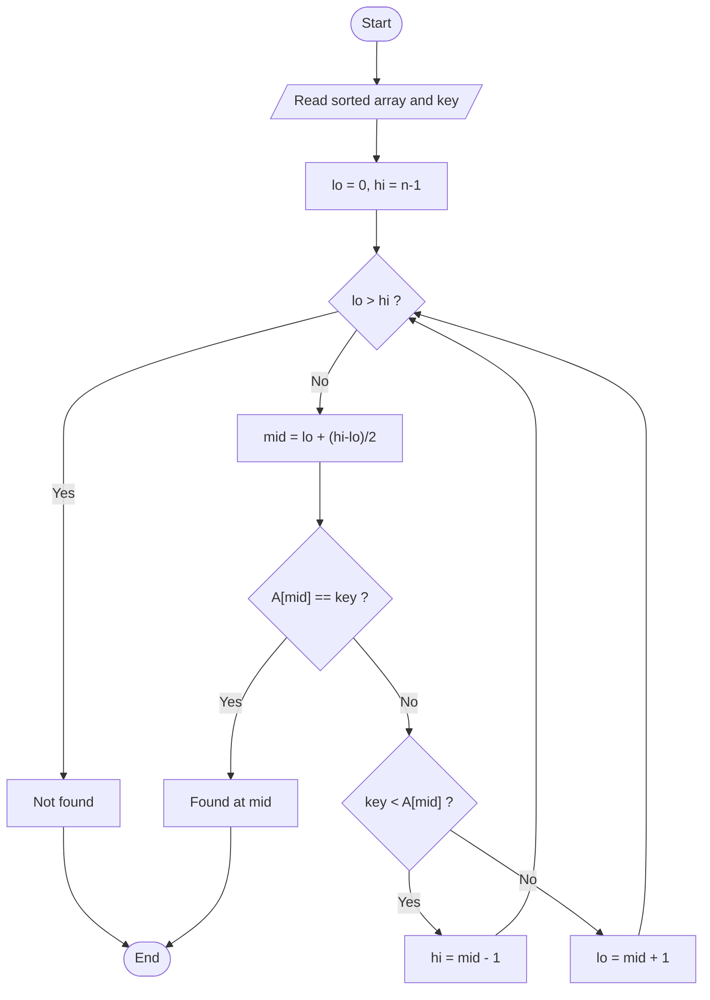

# Binary Search

> Unit 2 - Divide and Conquer &nbsp;|&nbsp; Source: [`binary_search.cpp`](binary_search.cpp) &nbsp;|&nbsp; Code explanation: [`binary_search.txt`](binary_search.txt)

## Problem Statement
Find a key in a sorted array in logarithmic time.

## Algorithm / Approach
Look at the middle element. If it equals the key we are done; if the key is smaller, search only the left half, otherwise only the right half. Each step discards half of the remaining elements. The program reads the array in ascending order (input is rejected if a value is smaller than the previous one) and prints each index it inspects.

## Pseudocode
```text
BinarySearch(A, lo, hi, key)
    if lo > hi then return -1
    mid <- lo + (hi - lo) / 2
    if A[mid] = key then return mid
    if key < A[mid] then return BinarySearch(A, lo, mid-1, key)
    else return BinarySearch(A, mid+1, hi, key)
```

## Flowchart


## Dry Run
```text
A = [2 5 8 12 16 23 38], key = 23
lo=0 hi=6 mid=3 A[3]=12 < 23 -> go right (lo=4)
lo=4 hi=6 mid=5 A[5]=23 == 23 -> found at index 5
```

## Time & Space Complexity
| Best | Average | Worst | Space |
|---|---|---|---|
| O(1) | O(log n) | O(log n) | O(log n) recursion stack |

## Compile and Run
```powershell
g++ binary_search.cpp -o binary_search
.\binary_search.exe
```

## Sample Run
```text
Enter number of elements (1-100): 7
Enter 7 elements in ascending order: 2 5 8 12 16 23 38
Enter key to search: 23
  checking index 3 (value 12)
  checking index 5 (value 23)
Key 23 found at index 5.
```


## Learning Outcomes
- Apply divide and conquer to searching.
- Understand why the data must be sorted.
- Write the mid-point as `lo + (hi-lo)/2` to avoid overflow.
