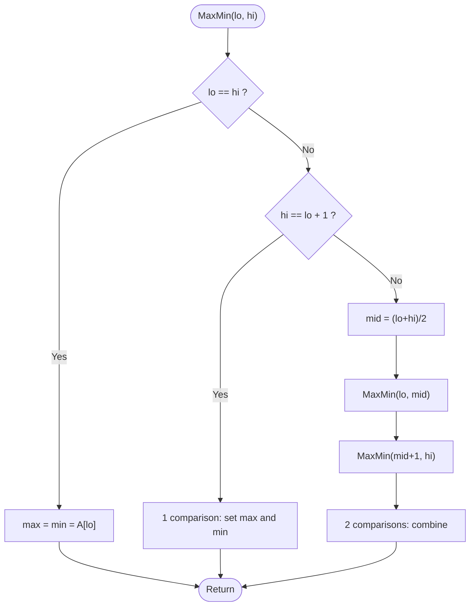

# Max-Min (Divide and Conquer)

> Unit 2 - Divide and Conquer &nbsp;|&nbsp; Source: [`max_min.cpp`](max_min.cpp) &nbsp;|&nbsp; Code explanation: [`max_min.txt`](max_min.txt)

## Problem Statement
Find the largest and the smallest element of an array using as few comparisons as possible.

## Algorithm / Approach
Split the array in two halves, find (max, min) of each half recursively, then combine with just two comparisons (larger of the maxima, smaller of the minima). Base cases: one element (0 comparisons) and two elements (1 comparison). This needs about 3n/2 - 2 comparisons instead of 2(n-1) for a simple scan.

## Pseudocode
```text
MaxMin(A, lo, hi) -> (max, min)
    if lo = hi then return (A[lo], A[lo])
    if hi = lo+1 then compare once; return (bigger, smaller)
    mid <- (lo + hi) / 2
    (max1, min1) <- MaxMin(A, lo, mid)
    (max2, min2) <- MaxMin(A, mid+1, hi)
    return (larger of max1,max2 ; smaller of min1,min2)
```

## Flowchart


## Dry Run
```text
A = [22 -5 13 9 40 1 7 -12]
[22,-5] -> (22,-5)   [13,9] -> (13,9)   [40,1] -> (40,1)   [7,-12] -> (7,-12)   (4 comparisons)
combine -> (22,-5)+(13,9)=(22,-5)   (40,1)+(7,-12)=(40,-12)   (4 comparisons)
combine -> max 40, min -12   (2 comparisons)   total = 10 = 3*8/2 - 2
```

## Time & Space Complexity
| Best | Average | Worst | Space |
|---|---|---|---|
| O(n) | O(n) | O(n)  (3n/2 - 2 comparisons) | O(log n) recursion stack |

## Compile and Run
```powershell
g++ max_min.cpp -o max_min
.\max_min.exe
```

## Sample Run
```text
Enter number of elements (1-100): 8
Enter 8 elements: 22 -5 13 9 40 1 7 -12
Maximum = 40, Minimum = -12
Comparisons used: 10 (simple scan would use 14)
```


## Learning Outcomes
- Use divide and conquer to reduce the constant factor, not just the Big-O.
- Return two values from a function using reference parameters.
- Derive the recurrence T(n) = 2T(n/2) + 2.
