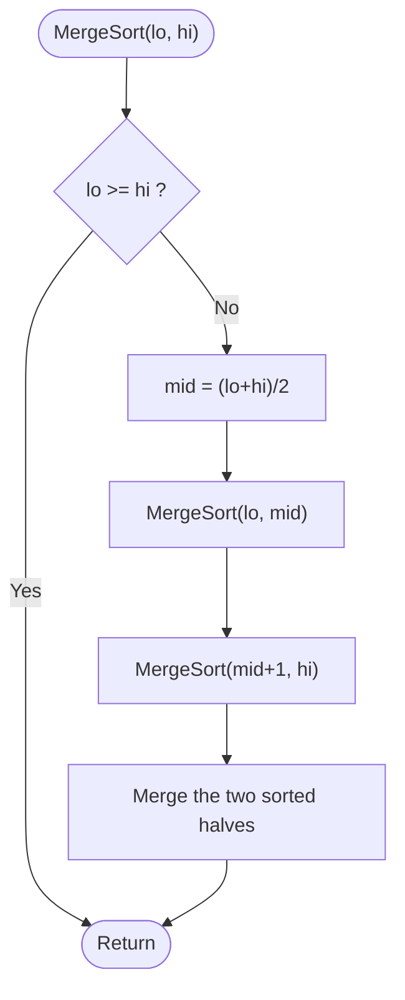

# Merge Sort

> Unit 2 - Divide and Conquer &nbsp;|&nbsp; Source: [`merge_sort.cpp`](merge_sort.cpp) &nbsp;|&nbsp; Code explanation: [`merge_sort.txt`](merge_sort.txt)

## Problem Statement
Sort an array of integers in ascending order in O(n log n) time in every case.

## Algorithm / Approach
Divide the array into two halves, sort each half recursively, then merge the two sorted halves by repeatedly taking the smaller front element. Using `<=` while merging keeps equal elements in their original order (stable sort). A helper array `temp` holds the merged result before it is copied back.

## Pseudocode
```text
MergeSort(A, lo, hi)
    if lo >= hi then return
    mid <- (lo + hi) / 2
    MergeSort(A, lo, mid);  MergeSort(A, mid+1, hi)
    Merge(A, lo, mid, hi)

Merge: i <- lo, j <- mid+1
    while both halves have elements: copy the smaller of A[i], A[j] to temp
    copy leftovers; copy temp back to A[lo..hi]
```

## Flowchart


## Dry Run
```text
[38 27 43 3]  ->  [38 27] [43 3]  ->  [38] [27] [43] [3]
merge: [27 38]   [3 43]
merge: [3 27 38 43]
```

## Time & Space Complexity
| Best | Average | Worst | Space |
|---|---|---|---|
| O(n log n) | O(n log n) | O(n log n) | O(n) helper array |

## Compile and Run
```powershell
g++ merge_sort.cpp -o merge_sort
.\merge_sort.exe
```

## Sample Run
```text
Enter number of elements (1-100): 8
Enter 8 elements: 38 27 43 3 9 82 10 3
Sorted array: 3 3 9 10 27 38 43 82
```


## Learning Outcomes
- Understand the divide / conquer / combine steps in code.
- Derive T(n) = 2T(n/2) + O(n) = O(n log n).
- Know merge sort is stable but needs extra memory.
