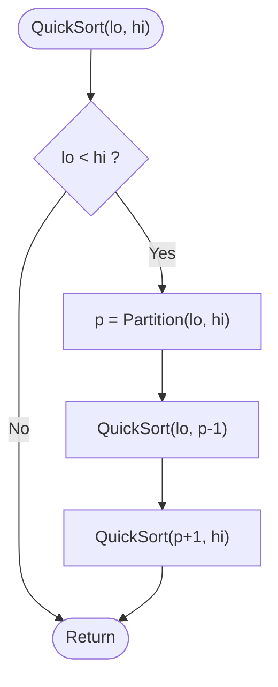

# Quick Sort

> Unit 2 - Divide and Conquer &nbsp;|&nbsp; Source: [`quick_sort.cpp`](quick_sort.cpp) &nbsp;|&nbsp; Code explanation: [`quick_sort.txt`](quick_sort.txt)

## Problem Statement
Sort an array of integers in ascending order, in place, with excellent average performance.

## Algorithm / Approach
Choose the last element as the pivot. Partition (Lomuto scheme): move every element <= pivot to the left part, then put the pivot right after them; it is now in its final position. Recursively sort the part before and the part after the pivot. Already-sorted input is the worst case with this pivot rule: O(n^2).

## Pseudocode
```text
QuickSort(A, lo, hi)
    if lo < hi then
        p <- Partition(A, lo, hi)
        QuickSort(A, lo, p-1);  QuickSort(A, p+1, hi)

Partition(A, lo, hi)
    pivot <- A[hi];  i <- lo-1
    for j <- lo to hi-1
        if A[j] <= pivot then i <- i+1; swap A[i], A[j]
    swap A[i+1], A[hi];  return i+1
```

## Flowchart


## Dry Run
```text
A = [10 80 30 90 40 50 70], pivot = 70
scan: 10,30,40,50 are <= 70 and move left -> [10 30 40 50 | 80 90 70]
put pivot in place -> [10 30 40 50 70 90 80]   pivot index = 4
left [10 30 40 50] and right [90 80] are sorted the same way
```

## Time & Space Complexity
| Best | Average | Worst | Space |
|---|---|---|---|
| O(n log n) | O(n log n) | O(n^2) | O(log n) average stack, O(n) worst |

## Compile and Run
```powershell
g++ quick_sort.cpp -o quick_sort
.\quick_sort.exe
```

## Sample Run
```text
Enter number of elements (1-100): 7
Enter 7 elements: 10 80 30 90 40 50 70
Sorted array: 10 30 40 50 70 80 90
```


## Learning Outcomes
- Understand partitioning and the idea of a pivot in its final place.
- See how the pivot choice decides best/worst case.
- Sort in place without a helper array.
