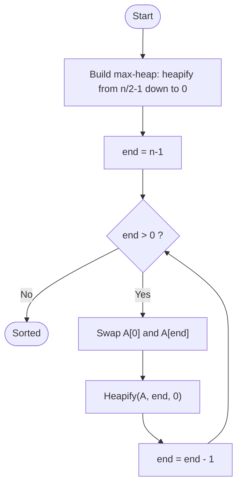

# Heap Sort

> Unit 2 - Divide and Conquer &nbsp;|&nbsp; Source: [`heap_sort.cpp`](heap_sort.cpp) &nbsp;|&nbsp; Code explanation: [`heap_sort.txt`](heap_sort.txt)

## Problem Statement
Sort an array in O(n log n) time in the worst case using only O(1) extra space.

## Algorithm / Approach
Rearrange the array into a max-heap (every parent >= its children, children of i are 2i+1 and 2i+2). The largest element is then at index 0: swap it with the last element, shrink the heap by one, and restore the heap property with `heapify`. Repeat until the heap is empty.

## Pseudocode
```text
HeapSort(A, n)
    for i <- n/2 - 1 downto 0 do Heapify(A, n, i)      # build max-heap
    for end <- n-1 downto 1
        swap A[0], A[end]
        Heapify(A, end, 0)

Heapify(A, n, i)
    largest <- i; l <- 2i+1; r <- 2i+2
    if l < n and A[l] > A[largest] then largest <- l
    if r < n and A[r] > A[largest] then largest <- r
    if largest != i then swap A[i], A[largest]; Heapify(A, n, largest)
```

## Flowchart


## Dry Run
```text
A = [12 11 13 5 6 7 20]
build max-heap -> [20 11 13 5 6 7 12]
swap 20 with last, heapify -> [13 11 12 5 6 7 | 20]
swap 13 with last, heapify -> [12 11 7 5 6 | 13 20] ... until sorted: [5 6 7 11 12 13 20]
```

## Time & Space Complexity
| Best | Average | Worst | Space |
|---|---|---|---|
| O(n log n) | O(n log n) | O(n log n) | O(1) (recursion in heapify: O(log n)) |

## Compile and Run
```powershell
g++ heap_sort.cpp -o heap_sort
.\heap_sort.exe
```

## Sample Run
```text
Enter number of elements (1-100): 7
Enter 7 elements: 12 11 13 5 6 7 20
Sorted array: 5 6 7 11 12 13 20
```


## Learning Outcomes
- Understand the array representation of a binary heap.
- Know that build-heap is O(n) and each extraction costs O(log n).
- Compare an in-place O(n log n) worst-case sort with merge and quick sort.
