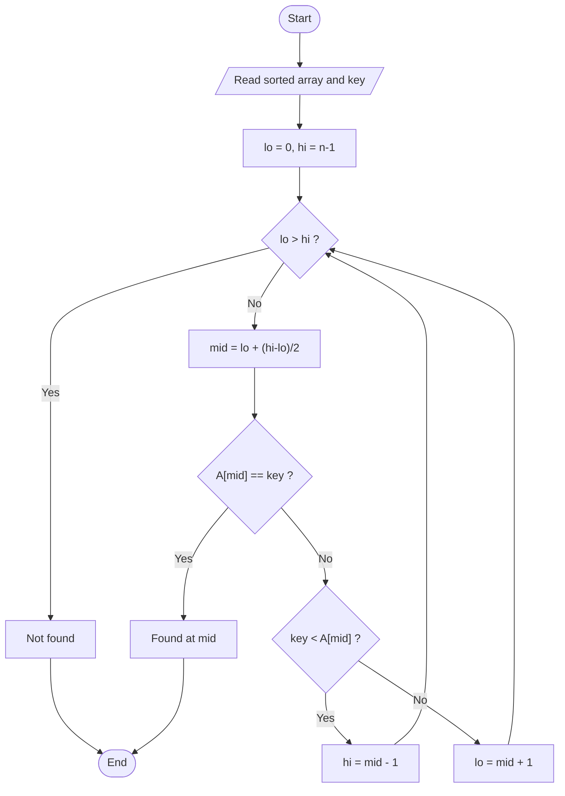
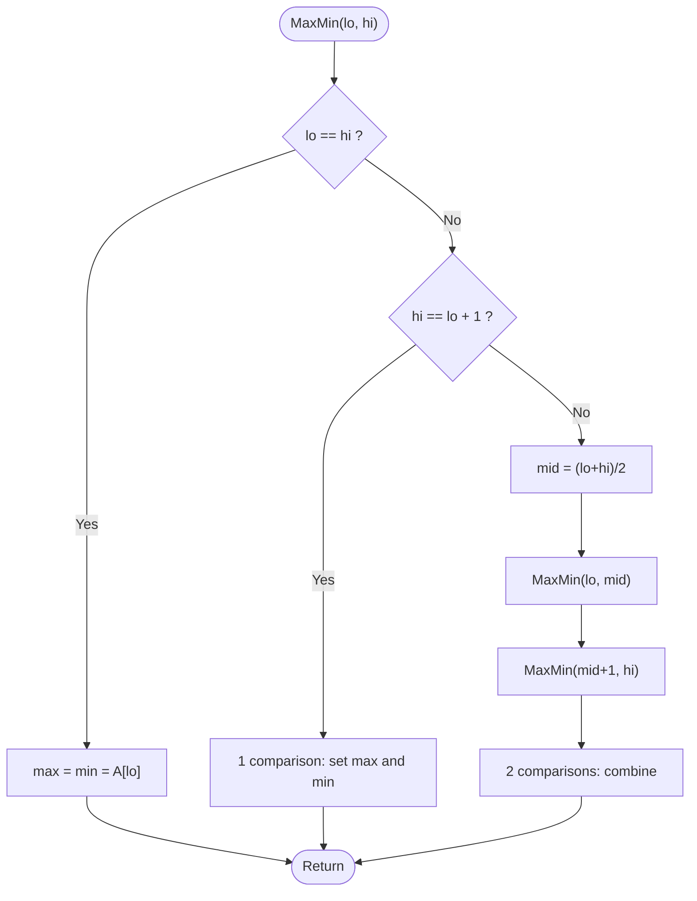
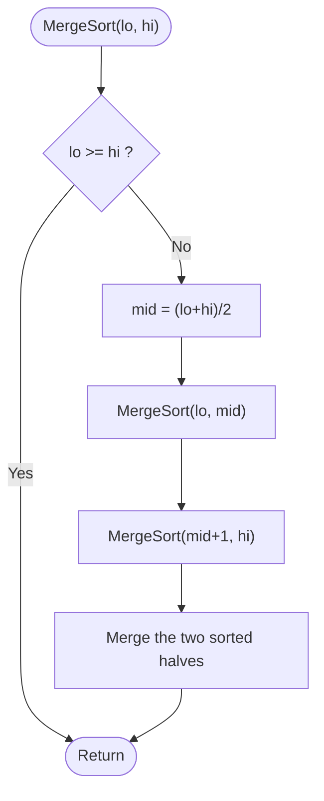
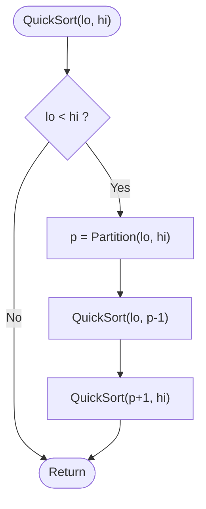
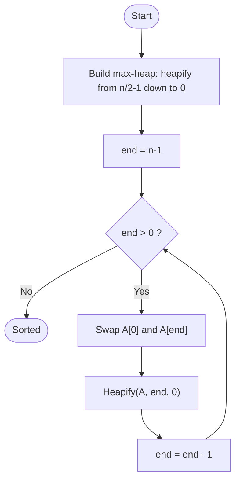
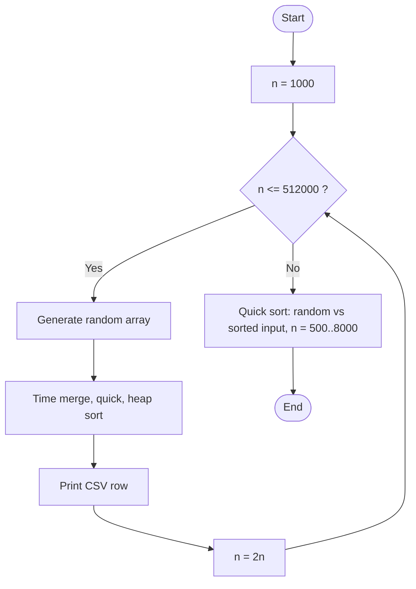

# Unit 02 - Divide and Conquer

Split a problem into smaller independent sub-problems, solve each one (usually recursively), then combine the answers. Binary search, max-min and three classic sorts.

| Folder | Program | Worst-case time | Space |
|---|---|---|---|
| 01-Binary-Search | [Binary Search](01-Binary-Search/README.md) | O(log n) | O(log n) recursion stack |
| 02-Max-Min | [Max-Min (Divide and Conquer)](02-Max-Min/README.md) | O(n)  (3n/2 - 2 comparisons) | O(log n) recursion stack |
| 03-Merge-Sort | [Merge Sort](03-Merge-Sort/README.md) | O(n log n) | O(n) helper array |
| 04-Quick-Sort | [Quick Sort](04-Quick-Sort/README.md) | O(n^2) | O(log n) average stack, O(n) worst |
| 05-Heap-Sort | [Heap Sort](05-Heap-Sort/README.md) | O(n log n) | O(1) (recursion in heapify: O(log n)) |
| 06-Sorting-Performance | [Performance Measurement: Merge, Quick and Heap Sort](06-Sorting-Performance/README.md) | O(n log n); quick sort worst case O(n^2) | O(n) |

Each program folder contains the C++ source, a `.txt` code explanation with the same file name, and a `README.md` (problem, approach, pseudocode, flowchart, complexity, learning outcomes).

## Binary Search
**Problem:** Find a key in a sorted array in logarithmic time.

Flowchart:

Dry run:
```text
A = [2 5 8 12 16 23 38], key = 23
lo=0 hi=6 mid=3 A[3]=12 < 23 -> go right (lo=4)
lo=4 hi=6 mid=5 A[5]=23 == 23 -> found at index 5
```
Details: [01-Binary-Search/README.md](01-Binary-Search/README.md)

## Max-Min (Divide and Conquer)
**Problem:** Find the largest and the smallest element of an array using as few comparisons as possible.

Flowchart:

Dry run:
```text
A = [22 -5 13 9 40 1 7 -12]
[22,-5] -> (22,-5)   [13,9] -> (13,9)   [40,1] -> (40,1)   [7,-12] -> (7,-12)   (4 comparisons)
combine -> (22,-5)+(13,9)=(22,-5)   (40,1)+(7,-12)=(40,-12)   (4 comparisons)
combine -> max 40, min -12   (2 comparisons)   total = 10 = 3*8/2 - 2
```
Details: [02-Max-Min/README.md](02-Max-Min/README.md)

## Merge Sort
**Problem:** Sort an array of integers in ascending order in O(n log n) time in every case.

Flowchart:

Dry run:
```text
[38 27 43 3]  ->  [38 27] [43 3]  ->  [38] [27] [43] [3]
merge: [27 38]   [3 43]
merge: [3 27 38 43]
```
Details: [03-Merge-Sort/README.md](03-Merge-Sort/README.md)

## Quick Sort
**Problem:** Sort an array of integers in ascending order, in place, with excellent average performance.

Flowchart:

Dry run:
```text
A = [10 80 30 90 40 50 70], pivot = 70
scan: 10,30,40,50 are <= 70 and move left -> [10 30 40 50 | 80 90 70]
put pivot in place -> [10 30 40 50 70 90 80]   pivot index = 4
left [10 30 40 50] and right [90 80] are sorted the same way
```
Details: [04-Quick-Sort/README.md](04-Quick-Sort/README.md)

## Heap Sort
**Problem:** Sort an array in O(n log n) time in the worst case using only O(1) extra space.

Flowchart:

Dry run:
```text
A = [12 11 13 5 6 7 20]
build max-heap -> [20 11 13 5 6 7 12]
swap 20 with last, heapify -> [13 11 12 5 6 7 | 20]
swap 13 with last, heapify -> [12 11 7 5 6 | 13 20] ... until sorted: [5 6 7 11 12 13 20]
```
Details: [05-Heap-Sort/README.md](05-Heap-Sort/README.md)

## Performance Measurement: Merge, Quick and Heap Sort
**Problem:** Measure and compare the running time of merge sort, quick sort and heap sort, and compare the measurements with the theoretical O(n log n) (and O(n^2) for quick sort's worst case).

Flowchart:

Dry run:
```text
Doubling n multiplies n log n by a little more than 2 (e.g. 16000 -> 32000: 2 x 15/14 = 2.14),
so each timing should be about 2.1x the previous one.  For O(n^2) it would be 4x.
```
Details: [06-Sorting-Performance/README.md](06-Sorting-Performance/README.md)
