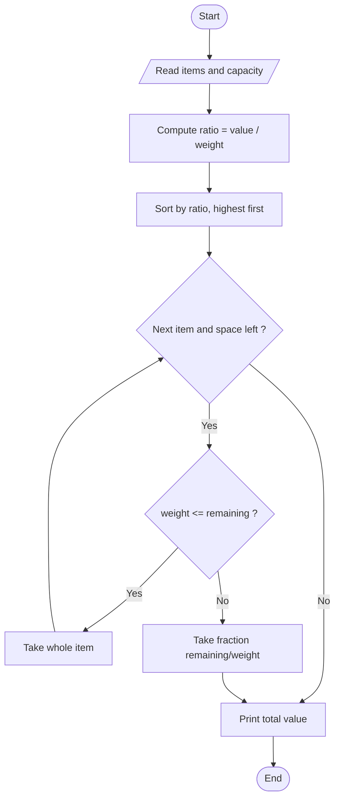

# Fractional Knapsack

> Unit 3 - Greedy Method &nbsp;|&nbsp; Source: [`fractional_knapsack.cpp`](fractional_knapsack.cpp) &nbsp;|&nbsp; Code explanation: [`fractional_knapsack.txt`](fractional_knapsack.txt)

## Problem Statement
A knapsack holds weight W. Each item has a weight and a value and may be taken in part. Maximise the total value carried.

## Algorithm / Approach
Greedy choice: value-per-weight ratio. Sort items by ratio (highest first) and take whole items while they fit; for the first item that does not fit, take the fraction that fills the knapsack and stop. This is optimal because a unit of weight is always best spent on the highest ratio available.

## Pseudocode
```text
FractionalKnapsack(items, W)
    sort items by value/weight in decreasing order
    remaining <- W;  total <- 0
    for each item in sorted order while remaining > 0
        if item.weight <= remaining then take all: total += value; remaining -= weight
        else take fraction f = remaining/weight: total += f * value; remaining <- 0
    return total
```

## Flowchart


## Dry Run
```text
W = 50: (w,v) = (10,60) ratio 6, (20,100) ratio 5, (30,120) ratio 4
take item1 fully: value 60, space 40 left
take item2 fully: value 160, space 20 left
item3 weighs 30 > 20 -> take 20/30 = 66.67%: +80  -> total 240
```

## Time & Space Complexity
| Best | Average | Worst | Space |
|---|---|---|---|
| O(n log n) | O(n log n) | O(n log n) (selection sort used here: O(n^2)) | O(1) |

## Compile and Run
```powershell
g++ fractional_knapsack.cpp -o fractional_knapsack
.\fractional_knapsack.exe
```

## Sample Run
```text
Enter number of items (1-20): 3
Enter knapsack capacity (1-1000): 50
Item 1 - weight and value: 10 60
Item 2 - weight and value: 20 100
Item 3 - weight and value: 30 120

Item  Weight  Value  Ratio  Taken
1     10      60     6      100%
2     20      100    5      100%
3     30      120    4      66.6667%
Maximum value = 240
```


## Learning Outcomes
- Identify a greedy choice and justify it.
- Understand why the greedy method fails for 0/1 knapsack but works here.
- Handle a fractional (partial) selection.
