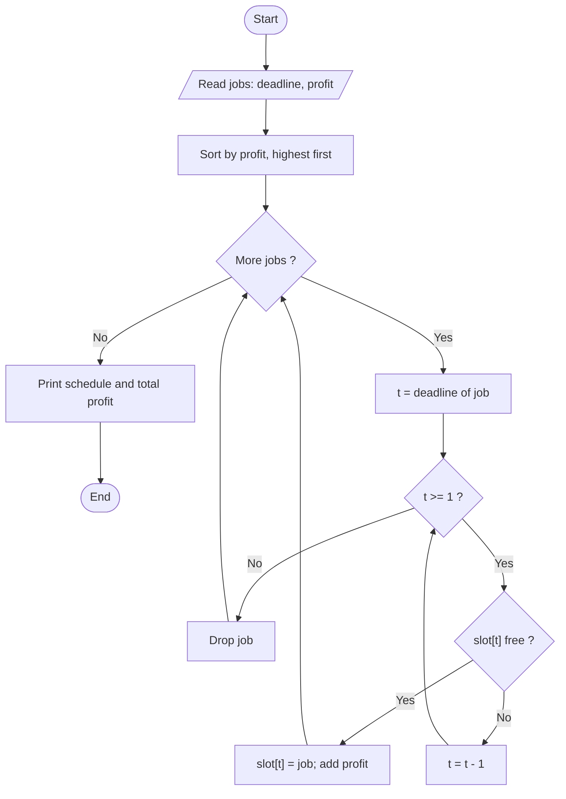

# Job Sequencing with Deadlines

> Unit 3 - Greedy Method &nbsp;|&nbsp; Source: [`job_sequencing.cpp`](job_sequencing.cpp) &nbsp;|&nbsp; Code explanation: [`job_sequencing.txt`](job_sequencing.txt)

## Problem Statement
Each job takes one unit of time, has a deadline and a profit. Schedule jobs on one machine so that each chosen job finishes by its deadline and the total profit is maximum.

## Algorithm / Approach
Greedy choice: highest profit first. Sort jobs by profit (descending). For each job, place it in the latest free time slot that is on or before its deadline; if no such slot exists, the job is dropped. Using the latest possible slot keeps earlier slots free for other jobs.

## Pseudocode
```text
JobSequencing(jobs, n)
    sort jobs by profit in decreasing order
    slot[1..maxDeadline] <- empty
    for each job in sorted order
        for t <- job.deadline downto 1
            if slot[t] is empty then slot[t] <- job; profit += job.profit; break
    return slot, profit
```

## Flowchart


## Dry Run
```text
Jobs (deadline, profit): J1(2,100) J2(1,19) J3(2,27) J4(1,25) J5(3,15)
sorted by profit: J1 100, J3 27, J4 25, J2 19, J5 15
J1 -> slot 2     J3 -> slot 2 taken -> slot 1     J4 (d=1) slot 1 taken -> dropped
J2 (d=1) dropped     J5 -> slot 3        schedule J3, J1, J5, profit 142
```

## Time & Space Complexity
| Best | Average | Worst | Space |
|---|---|---|---|
| O(n^2) | O(n^2) | O(n^2) | O(maxDeadline) |

## Compile and Run
```powershell
g++ job_sequencing.cpp -o job_sequencing
.\job_sequencing.exe
```

## Sample Run
```text
Enter number of jobs (1-10): 5
Job 1 - deadline and profit: 2 100
Job 2 - deadline and profit: 1 19
Job 3 - deadline and profit: 2 27
Job 4 - deadline and profit: 1 25
Job 5 - deadline and profit: 3 15

Schedule (time slot -> job): [1: J3] [2: J1] [3: J5] 
Total profit = 142
```


## Learning Outcomes
- Apply the greedy strategy to scheduling.
- Understand why 'latest free slot' is the right placement.
- Use a simple slot array as a schedule.
