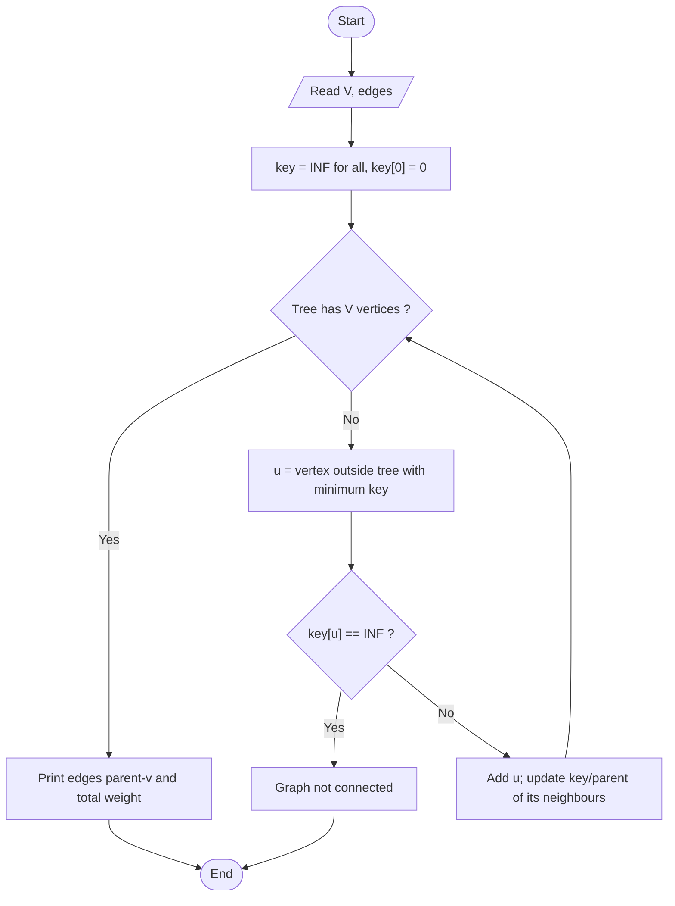

# Prim's Minimum Spanning Tree

> Unit 3 - Greedy Method &nbsp;|&nbsp; Source: [`prims_mst.cpp`](prims_mst.cpp) &nbsp;|&nbsp; Code explanation: [`prims_mst.txt`](prims_mst.txt)

## Problem Statement
Given a connected, weighted, undirected graph, find a spanning tree (V-1 edges connecting all vertices) of minimum total weight.

## Algorithm / Approach
Greedy choice: cheapest edge leaving the tree. Start with vertex 0. Keep `key[v]` = cheapest known edge from the tree to v. Repeatedly add the vertex with the smallest key, then update the keys of its neighbours. An adjacency matrix gives O(V^2) time.

## Pseudocode
```text
Prim(G, V)
    key[all] <- INF;  key[0] <- 0;  parent[0] <- -1
    repeat V times
        u <- vertex not in tree with smallest key[u]
        add u to tree
        for each neighbour v of u not in tree
            if w(u,v) < key[v] then key[v] <- w(u,v); parent[v] <- u
```

## Flowchart


## Dry Run
```text
Edges: 0-1:2, 0-3:6, 1-2:3, 1-3:8, 1-4:5, 2-4:7, 3-4:9
start 0 -> add edge 0-1 (2) -> cheapest leaving {0,1}: 1-2 (3) -> then 1-4 (5) -> then 0-3 (6)
MST = {0-1, 1-2, 1-4, 0-3}, weight 2+3+5+6 = 16
```

## Time & Space Complexity
| Best | Average | Worst | Space |
|---|---|---|---|
| O(V^2) | O(V^2) | O(V^2)  (O(E log V) with a heap) | O(V^2) matrix |

## Compile and Run
```powershell
g++ prims_mst.cpp -o prims_mst
.\prims_mst.exe
```

## Sample Run
```text
Enter number of vertices (2-10): 5
Enter number of edges: 7
Enter each edge as: u v weight (vertices are 0 to 4)
Edge 1: 0 1 2
Edge 2: 0 3 6
Edge 3: 1 2 3
Edge 4: 1 3 8
Edge 5: 1 4 5
Edge 6: 2 4 7
Edge 7: 3 4 9

Edges in the Minimum Spanning Tree:
0 - 1  (weight 2)
1 - 2  (weight 3)
0 - 3  (weight 6)
1 - 4  (weight 5)
Total weight = 16
```


## Learning Outcomes
- Understand the cut property behind MST algorithms.
- Use adjacency-matrix graphs.
- Detect a disconnected graph.
