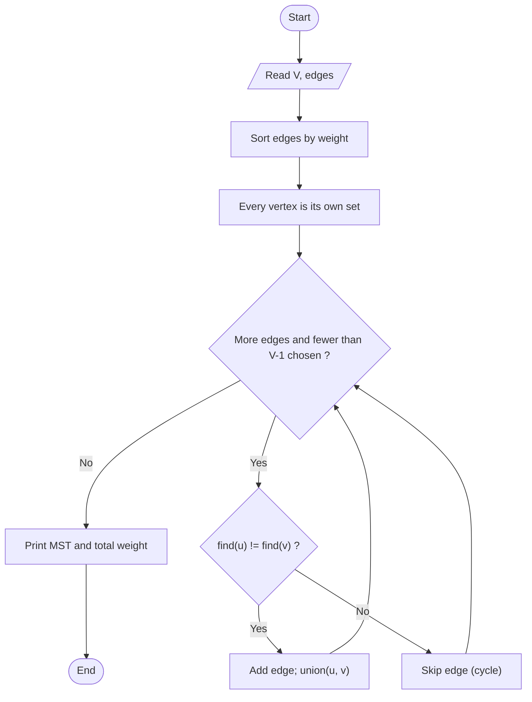

# Kruskal's Minimum Spanning Tree

> Unit 3 - Greedy Method &nbsp;|&nbsp; Source: [`kruskals_mst.cpp`](kruskals_mst.cpp) &nbsp;|&nbsp; Code explanation: [`kruskals_mst.txt`](kruskals_mst.txt)

## Problem Statement
Find a minimum spanning tree of a connected, weighted, undirected graph by processing edges globally.

## Algorithm / Approach
Greedy choice: cheapest edge that does not create a cycle. Sort all edges by weight and scan them; add an edge if its endpoints belong to different components, which is tested with Union-Find (`findSet`, with path compression). Stop after V-1 edges.

## Pseudocode
```text
Kruskal(G)
    sort edges by weight
    make-set(v) for every vertex v
    for each edge (u, v, w) in sorted order
        if find(u) != find(v) then
            add edge to MST;  union(u, v)
    return MST
```

## Flowchart


## Dry Run
```text
sorted: 0-1:2, 1-2:3, 1-4:5, 0-3:6, 2-4:7, 1-3:8, 3-4:9
take 0-1  take 1-2  take 1-4  take 0-3   (4 edges = V-1, stop; 2-4 would form a cycle)
total = 2 + 3 + 5 + 6 = 16
```

## Time & Space Complexity
| Best | Average | Worst | Space |
|---|---|---|---|
| O(E log E) | O(E log E) | O(E log E)  (insertion sort used here: O(E^2)) | O(V + E) |

## Compile and Run
```powershell
g++ kruskals_mst.cpp -o kruskals_mst
.\kruskals_mst.exe
```

## Sample Run
```text
Enter number of vertices (2-10): 5
Enter number of edges: 7
Enter each edge as: u v weight (vertices are 0 to 4)
Edge 1: 0 1 2
Edge 2: 0 3 6
Edge 3: 1 2 3
Edge 4: 1 3 8
Edge 5: 1 4 5
Edge 6: 2 4 7
Edge 7: 3 4 9

Edges in the Minimum Spanning Tree:
0 - 1  (weight 2)
1 - 2  (weight 3)
1 - 4  (weight 5)
0 - 3  (weight 6)
Total weight = 16
```


## Learning Outcomes
- Understand and implement Union-Find with path compression.
- Compare edge-based (Kruskal) with vertex-based (Prim) greedy MST.
- Detect cycles efficiently.
