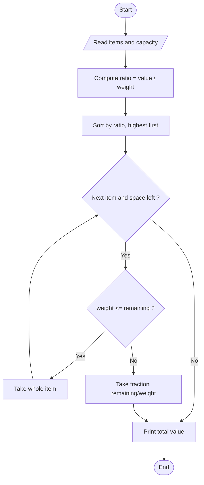
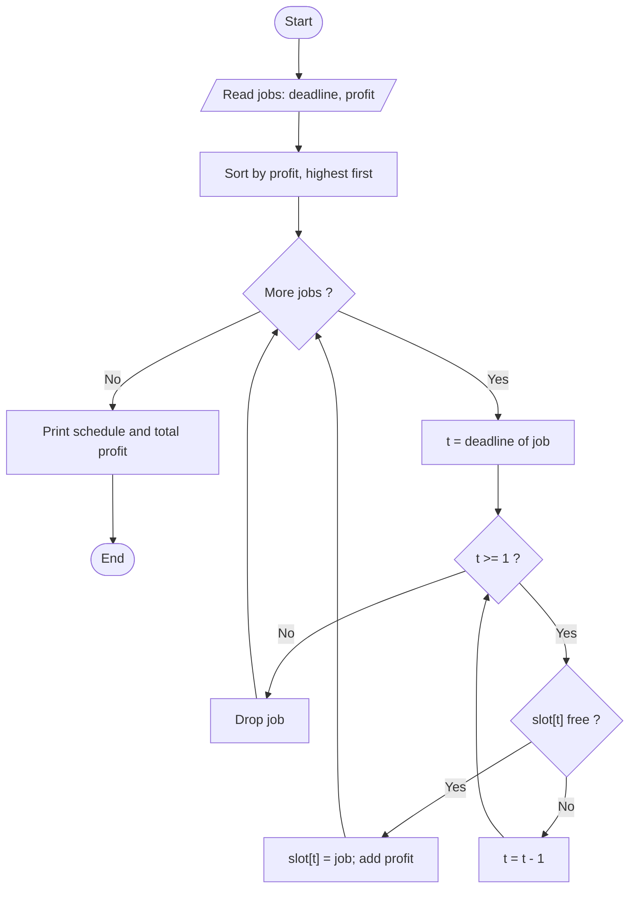
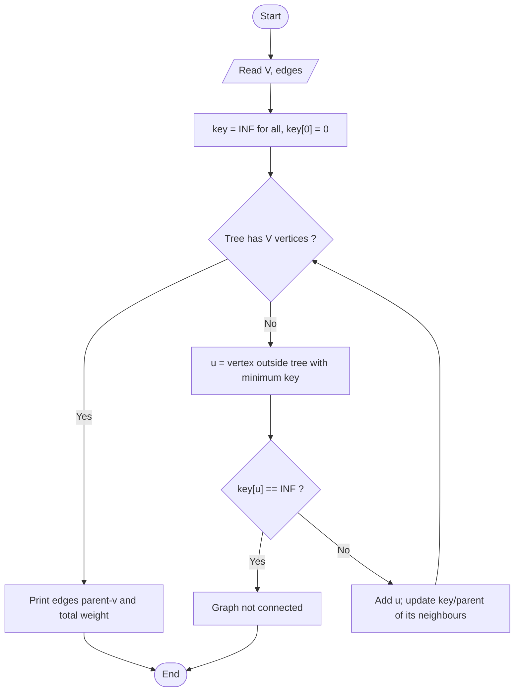
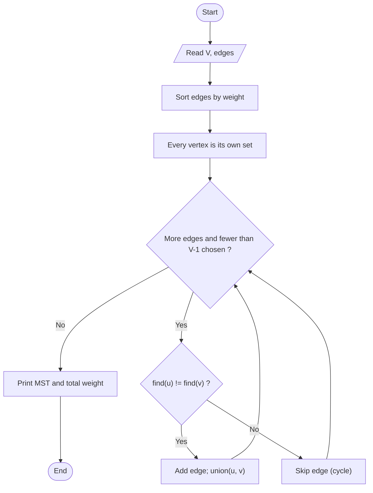

# Unit 03 - Greedy Method

Build the answer step by step, always taking the choice that looks best right now. Works when a local best choice is also globally optimal.

| Folder | Program | Worst-case time | Space |
|---|---|---|---|
| 01-Fractional-Knapsack | [Fractional Knapsack](01-Fractional-Knapsack/README.md) | O(n log n) (selection sort used here: O(n^2)) | O(1) |
| 02-Job-Sequencing | [Job Sequencing with Deadlines](02-Job-Sequencing/README.md) | O(n^2) | O(maxDeadline) |
| 03-Prims-MST | [Prim's Minimum Spanning Tree](03-Prims-MST/README.md) | O(V^2)  (O(E log V) with a heap) | O(V^2) matrix |
| 04-Kruskals-MST | [Kruskal's Minimum Spanning Tree](04-Kruskals-MST/README.md) | O(E log E)  (insertion sort used here: O(E^2)) | O(V + E) |

Each program folder contains the C++ source, a `.txt` code explanation with the same file name, and a `README.md` (problem, approach, pseudocode, flowchart, complexity, learning outcomes).

## Fractional Knapsack
**Problem:** A knapsack holds weight W. Each item has a weight and a value and may be taken in part. Maximise the total value carried.

Flowchart:

Dry run:
```text
W = 50: (w,v) = (10,60) ratio 6, (20,100) ratio 5, (30,120) ratio 4
take item1 fully: value 60, space 40 left
take item2 fully: value 160, space 20 left
item3 weighs 30 > 20 -> take 20/30 = 66.67%: +80  -> total 240
```
Details: [01-Fractional-Knapsack/README.md](01-Fractional-Knapsack/README.md)

## Job Sequencing with Deadlines
**Problem:** Each job takes one unit of time, has a deadline and a profit. Schedule jobs on one machine so that each chosen job finishes by its deadline and the total profit is maximum.

Flowchart:

Dry run:
```text
Jobs (deadline, profit): J1(2,100) J2(1,19) J3(2,27) J4(1,25) J5(3,15)
sorted by profit: J1 100, J3 27, J4 25, J2 19, J5 15
J1 -> slot 2     J3 -> slot 2 taken -> slot 1     J4 (d=1) slot 1 taken -> dropped
J2 (d=1) dropped     J5 -> slot 3        schedule J3, J1, J5, profit 142
```
Details: [02-Job-Sequencing/README.md](02-Job-Sequencing/README.md)

## Prim's Minimum Spanning Tree
**Problem:** Given a connected, weighted, undirected graph, find a spanning tree (V-1 edges connecting all vertices) of minimum total weight.

Flowchart:

Dry run:
```text
Edges: 0-1:2, 0-3:6, 1-2:3, 1-3:8, 1-4:5, 2-4:7, 3-4:9
start 0 -> add edge 0-1 (2) -> cheapest leaving {0,1}: 1-2 (3) -> then 1-4 (5) -> then 0-3 (6)
MST = {0-1, 1-2, 1-4, 0-3}, weight 2+3+5+6 = 16
```
Details: [03-Prims-MST/README.md](03-Prims-MST/README.md)

## Kruskal's Minimum Spanning Tree
**Problem:** Find a minimum spanning tree of a connected, weighted, undirected graph by processing edges globally.

Flowchart:

Dry run:
```text
sorted: 0-1:2, 1-2:3, 1-4:5, 0-3:6, 2-4:7, 1-3:8, 3-4:9
take 0-1  take 1-2  take 1-4  take 0-3   (4 edges = V-1, stop; 2-4 would form a cycle)
total = 2 + 3 + 5 + 6 = 16
```
Details: [04-Kruskals-MST/README.md](04-Kruskals-MST/README.md)
