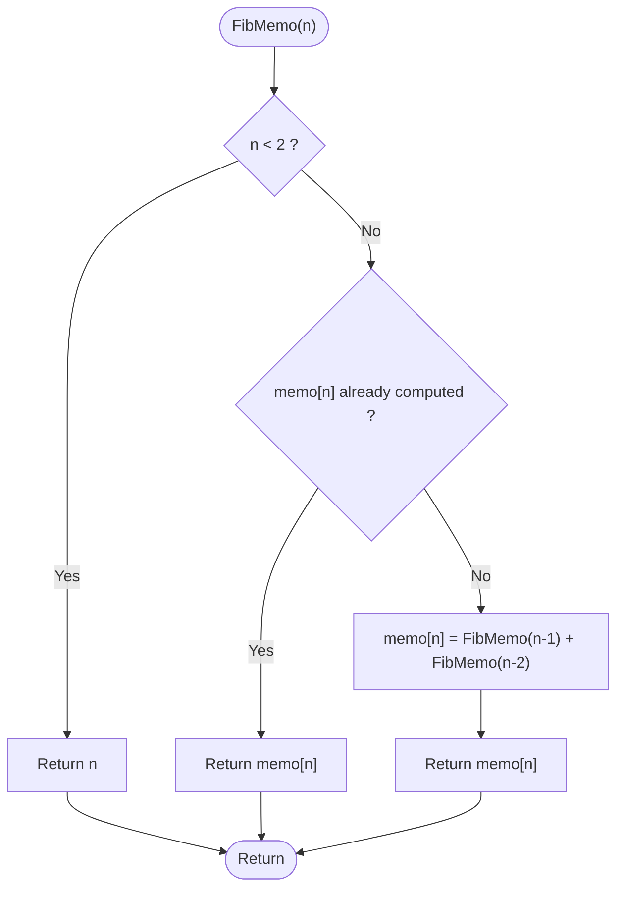

# Memoized Fibonacci

> Unit 4 - Dynamic Programming &nbsp;|&nbsp; Source: [`memoized_fibonacci.cpp`](memoized_fibonacci.cpp) &nbsp;|&nbsp; Code explanation: [`memoized_fibonacci.txt`](memoized_fibonacci.txt)

## Problem Statement
Compute the n-th Fibonacci number efficiently. fib(0)=0, fib(1)=1, fib(n)=fib(n-1)+fib(n-2).

## Algorithm / Approach
Plain recursion recomputes the same values again and again (exponential time). Memoization (top-down DP) stores each fib(i) in a table the first time it is computed, so every value is computed exactly once. The program prints the number of function calls of both versions to show the difference.

## Pseudocode
```text
FibMemo(n)
    if n < 2 then return n
    if memo[n] is known then return memo[n]
    memo[n] <- FibMemo(n-1) + FibMemo(n-2)
    return memo[n]
```

## Flowchart


## Dry Run
```text
fib(5): calls fib(4) and fib(3). fib(4) calls fib(3) and fib(2) ... the first time fib(3) is solved it is stored;
the second request for fib(3) returns instantly.  Only fib(0..5) are ever computed: 2n-1 calls in total.
```

## Time & Space Complexity
| Best | Average | Worst | Space |
|---|---|---|---|
| O(n) | O(n) | O(n)  (plain recursion: O(2^n)) | O(n) |

## Compile and Run
```powershell
g++ memoized_fibonacci.cpp -o memoized_fibonacci
.\memoized_fibonacci.exe
```

## Sample Run
```text
Enter n (0-90): 30
Memoized  : fib(30) = 832040, calls = 59
Plain     : fib(30) = 832040, calls = 2692537
```


## Experiment: Number of Function Calls
Counts printed by the program for several n ([`fibonacci_calls.csv`](../../docs/complexity-analysis/fibonacci_calls.csv)):

| n | plain_calls | memo_calls |
|---|---|---|
| 5 | 15 | 9 |
| 10 | 177 | 19 |
| 15 | 1,973 | 29 |
| 20 | 21,891 | 39 |
| 25 | 242,785 | 49 |
| 30 | 2,692,540 | 59 |
| 35 | 29,860,700 | 69 |


Plain recursion grows by about x1.618 per step of n (O(2^n)); the memoized version needs only 2n - 1 calls (O(n)).

## Learning Outcomes
- Recognise overlapping sub-problems.
- Apply memoization (top-down DP).
- Measure the saving by counting calls.
