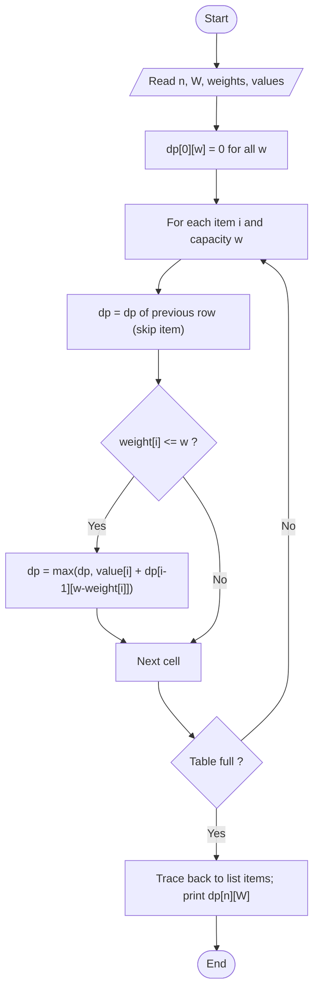

# 0/1 Knapsack

> Unit 4 - Dynamic Programming &nbsp;|&nbsp; Source: [`knapsack_01.cpp`](knapsack_01.cpp) &nbsp;|&nbsp; Code explanation: [`knapsack_01.txt`](knapsack_01.txt)

## Problem Statement
Each item can be taken completely or not at all. Choose items with total weight <= W and maximum total value.

## Algorithm / Approach
Let dp[i][w] = best value using only the first i items with capacity w. For item i: either skip it (dp[i-1][w]) or take it (value[i] + dp[i-1][w - weight[i]]) if it fits; keep the larger. The answer is dp[n][W]; walking back through the table (if dp[i][w] differs from dp[i-1][w], item i was taken) gives the chosen items. Greedy by ratio is NOT correct here.

## Pseudocode
```text
for i <- 0 to n: dp[i][0] <- 0;   for w <- 0 to W: dp[0][w] <- 0
for i <- 1 to n
    for w <- 0 to W
        dp[i][w] <- dp[i-1][w]
        if weight[i] <= w then dp[i][w] <- max(dp[i][w], value[i] + dp[i-1][w - weight[i]])
return dp[n][W]
```

## Flowchart


## Dry Run
```text
W = 8, items (w,v): 1:(2,3) 2:(3,4) 3:(4,5) 4:(5,6)
dp[4][8] = max(skip item 4 -> dp[3][8] = 9, take item 4 -> 6 + dp[3][3] = 6 + 4 = 10) = 10
trace back: item 4 taken (w -> 3); item 3: dp[3][3] = dp[2][3] -> skipped; item 2 taken (4)   => items 4 and 2
```

## Time & Space Complexity
| Best | Average | Worst | Space |
|---|---|---|---|
| O(nW) | O(nW) | O(nW) | O(nW) |

## Compile and Run
```powershell
g++ knapsack_01.cpp -o knapsack_01
.\knapsack_01.exe
```

## Sample Run
```text
Enter number of items (1-10): 4
Enter knapsack capacity (1-50): 8
Item 1 - weight and value: 2 3
Item 2 - weight and value: 3 4
Item 3 - weight and value: 4 5
Item 4 - weight and value: 5 6

DP table (rows = items 0..4, columns = capacity 0..8)
0	0	0	0	0	0	0	0	0	
0	0	3	3	3	3	3	3	3	
0	0	3	4	4	7	7	7	7	
0	0	3	4	5	7	8	9	9	
0	0	3	4	5	7	8	9	10	

Maximum value = 10
Items taken: 4 2
```


## Learning Outcomes
- Build a DP table bottom-up.
- Reconstruct the solution from the table.
- Understand pseudo-polynomial time.
