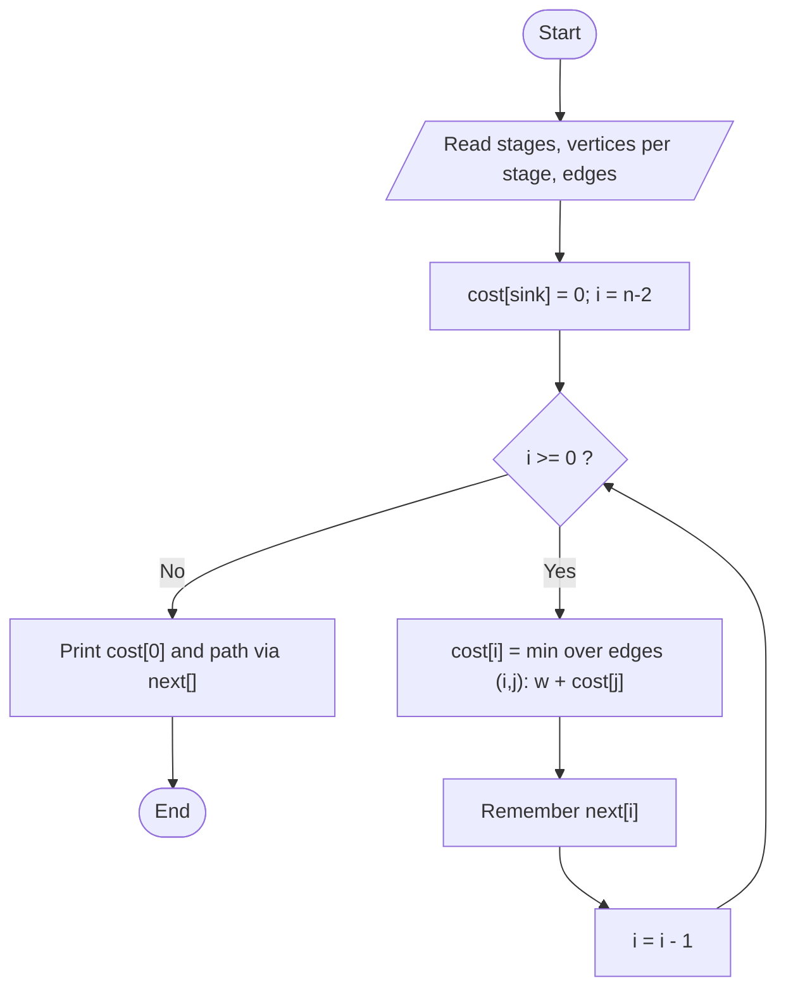

# Multistage Graph (Shortest Path)

> Unit 4 - Dynamic Programming &nbsp;|&nbsp; Source: [`multistage_graph.cpp`](multistage_graph.cpp) &nbsp;|&nbsp; Code explanation: [`multistage_graph.txt`](multistage_graph.txt)

## Problem Statement
A directed graph is divided into stages; every edge goes from one stage to the next. Find the cheapest path from the single source (stage 1) to the single sink (last stage).

## Algorithm / Approach
Work backwards: cost[i] = minimum over edges (i, j) of weight(i, j) + cost[j], with cost[sink] = 0. Because vertices are numbered stage by stage, processing i from n-2 down to 0 guarantees cost[j] is ready when needed. `nextVertex[i]` remembers the best choice so the path can be printed.

## Pseudocode
```text
cost[n-1] <- 0
for i <- n-2 downto 0
    cost[i] <- INF
    for each vertex j > i with an edge (i, j)
        if w(i,j) + cost[j] < cost[i] then cost[i] <- w(i,j) + cost[j]; next[i] <- j
print cost[0];  follow next[] from vertex 0
```

## Flowchart


## Dry Run
```text
Stages: {0} {1,2,3} {4,5} {6}
cost[6]=0; cost[4]=5; cost[5]=2
cost[1]=min(4+5, 6+2)=8   cost[2]=min(2+5, 7+2)=7   cost[3]=3+2=5
cost[0]=min(5+8, 3+7, 4+5)=9 via vertex 3  -> path 0 -> 3 -> 5 -> 6
```

## Time & Space Complexity
| Best | Average | Worst | Space |
|---|---|---|---|
| O(V + E) | O(V + E) | O(V^2) with the matrix used here | O(V^2) |

## Compile and Run
```powershell
g++ multistage_graph.cpp -o multistage_graph
.\multistage_graph.exe
```

## Sample Run
```text
Enter number of stages (2-6): 4
Vertices in stage 1: 1
Vertices in stage 2: 3
Vertices in stage 3: 2
Vertices in stage 4: 1
Enter number of edges (1-100): 10
Enter each edge as: u v weight (vertices 0 to 6, only to the next stage)
Edge 1: 0 1 5
Edge 2: 0 2 3
Edge 3: 0 3 4
Edge 4: 1 4 4
Edge 5: 1 5 6
Edge 6: 2 4 2
Edge 7: 2 5 7
Edge 8: 3 5 3
Edge 9: 4 6 5
Edge 10: 5 6 2

Minimum cost = 9
Path: 0 -> 3 -> 5 -> 6
```


## Learning Outcomes
- Apply backward DP on a layered graph.
- Understand the principle of optimality.
- Reconstruct a path using a 'next' array.
