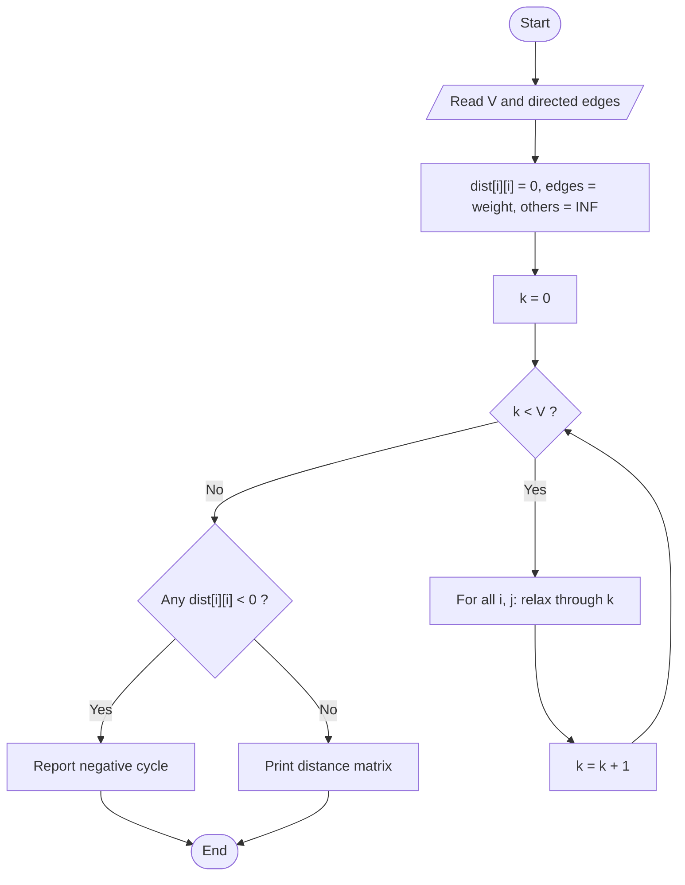

# Floyd-Warshall (All-Pairs Shortest Paths)

> Unit 4 - Dynamic Programming &nbsp;|&nbsp; Source: [`floyd_warshall.cpp`](floyd_warshall.cpp) &nbsp;|&nbsp; Code explanation: [`floyd_warshall.txt`](floyd_warshall.txt)

## Problem Statement
For a directed weighted graph (negative edges allowed, no negative cycles) find the shortest distance between every pair of vertices.

## Algorithm / Approach
Let dist[i][j] be the best known distance. For each vertex k in turn, check whether going i -> k -> j is shorter than the current i -> j and update. After processing k = 0..V-1 every shortest path has been considered. If any dist[i][i] becomes negative, a negative cycle exists.

## Pseudocode
```text
for k <- 0 to V-1
    for i <- 0 to V-1
        for j <- 0 to V-1
            if dist[i][k] + dist[k][j] < dist[i][j] then dist[i][j] <- dist[i][k] + dist[k][j]
if any dist[i][i] < 0 then negative cycle
```

## Flowchart


## Dry Run
```text
Edges: 0->1:5, 0->3:10, 1->2:3, 2->3:1
initially dist[0][3] = 10.  k=1: dist[0][2] = 5+3 = 8.  k=2: dist[0][3] = min(10, 8+1) = 9.
dist[1][3] = 3+1 = 4 as well.  Unreachable pairs stay INF.
```

## Time & Space Complexity
| Best | Average | Worst | Space |
|---|---|---|---|
| O(V^3) | O(V^3) | O(V^3) | O(V^2) |

## Compile and Run
```powershell
g++ floyd_warshall.cpp -o floyd_warshall
.\floyd_warshall.exe
```

## Sample Run
```text
Enter number of vertices (1-8): 4
Enter number of directed edges: 4
Enter each edge as: from to weight (weight -100 to 100)
Edge 1: 0 1 5
Edge 2: 0 3 10
Edge 3: 1 2 3
Edge 4: 2 3 1

Shortest distance matrix:
0	5	8	9	
INF	0	3	4	
INF	INF	0	1	
INF	INF	INF	0
```


## Learning Outcomes
- Understand the DP formulation over intermediate vertices.
- Handle INF safely so that INF + x is never added.
- Detect negative cycles.
