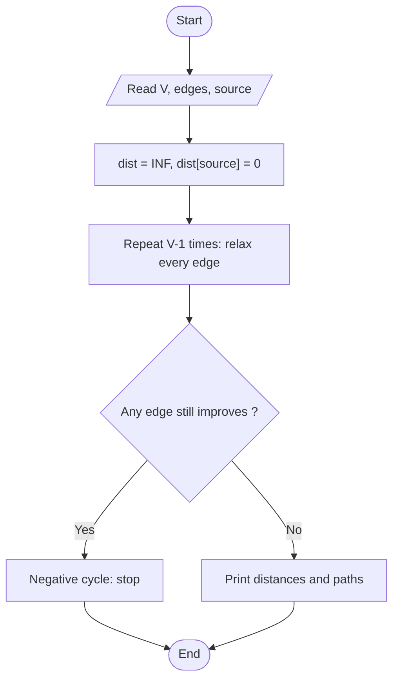

# Single-Source Shortest Path (Bellman-Ford)

> Unit 4 - Dynamic Programming &nbsp;|&nbsp; Source: [`bellman_ford.cpp`](bellman_ford.cpp) &nbsp;|&nbsp; Code explanation: [`bellman_ford.txt`](bellman_ford.txt)

## Problem Statement
Find the shortest distance from one source vertex to every other vertex in a directed graph that may contain negative edge weights.

## Algorithm / Approach
Dynamic programming over the number of edges: after round r, dist[v] is correct for all shortest paths using at most r edges. A shortest path has at most V-1 edges, so relaxing every edge V-1 times is enough. One more round that still improves a distance proves a negative cycle. `parent[]` lets the paths be printed.

## Pseudocode
```text
dist[all] <- INF;  dist[source] <- 0
repeat V-1 times
    for each edge (u, v, w)
        if dist[u] + w < dist[v] then dist[v] <- dist[u] + w; parent[v] <- u
for each edge (u, v, w)
    if dist[u] + w < dist[v] then report negative cycle
```

## Flowchart


## Dry Run
```text
Classic example, source 0:  0->1:6, 0->2:7, 1->2:8, 1->3:5, 1->4:-4, 2->3:-3, 2->4:9, 3->1:-2, 4->3:7, 4->0:2
round 1 (edges in input order) gives dist = [0, 2, 7, 4, 2]; round 2 improves vertex 4 to -2 (via 0-2-3-1-4); later rounds change nothing
final dist = [0, 2, 7, 4, -2]
```

## Time & Space Complexity
| Best | Average | Worst | Space |
|---|---|---|---|
| O(E) | O(VE) | O(VE) | O(V) |

## Compile and Run
```powershell
g++ bellman_ford.cpp -o bellman_ford
.\bellman_ford.exe
```

## Sample Run
```text
Enter number of vertices (1-10): 5
Enter number of directed edges (0-30): 10
Enter each edge as: from to weight (weight -100 to 100)
Edge 1: 0 1 6
Edge 2: 0 2 7
Edge 3: 1 2 8
Edge 4: 1 3 5
Edge 5: 1 4 -4
Edge 6: 2 3 -3
Edge 7: 2 4 9
Edge 8: 3 1 -2
Edge 9: 4 3 7
Edge 10: 4 0 2
Enter source vertex: 0

Shortest distances from vertex 0:
  to 0 : 0   path: 0
  to 1 : 2   path: 0 -> 2 -> 3 -> 1
  to 2 : 7   path: 0 -> 2
  to 3 : 4   path: 0 -> 2 -> 3
  to 4 : -2   path: 0 -> 2 -> 3 -> 1 -> 4
```


## Learning Outcomes
- Understand relaxation.
- Handle negative edge weights (where Dijkstra fails).
- Detect negative cycles.
