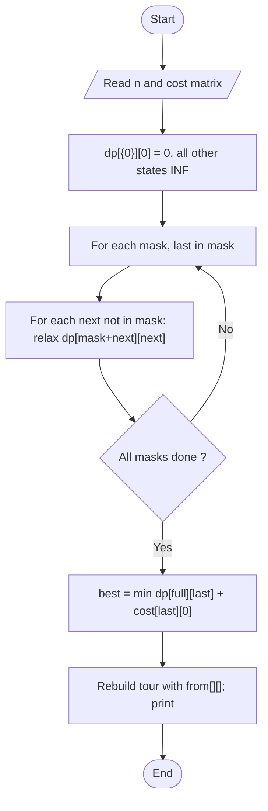

# Travelling Salesman Problem (Held-Karp DP)

> Unit 4 - Dynamic Programming &nbsp;|&nbsp; Source: [`tsp_dp.cpp`](tsp_dp.cpp) &nbsp;|&nbsp; Code explanation: [`tsp_dp.txt`](tsp_dp.txt)

## Problem Statement
Given the cost of travelling between every pair of n cities, find the cheapest tour that visits each city exactly once and returns to the start.

## Algorithm / Approach
Held-Karp dynamic programming over subsets: dp[mask][last] = minimum cost of a path that starts at city 0, visits exactly the cities in the bit-mask and ends at `last`. Extend every state by one unvisited city. The tour cost is min over last of dp[full][last] + cost[last][0]. `from[][]` stores predecessors so the tour can be printed. Time O(n^2 2^n) beats O(n!) of brute force.

## Pseudocode
```text
dp[all][all] <- INF;  dp[{0}][0] <- 0
for mask in increasing order
    for last in mask with dp[mask][last] < INF
        for next not in mask
            dp[mask + {next}][next] <- min(dp[mask + {next}][next], dp[mask][last] + cost[last][next])
answer <- min over last of dp[all][last] + cost[last][0]
```

## Flowchart


## Dry Run
```text
4 cities, cost rows (excluding diagonal): 0:[10 15 20] 1:[10 35 25] 2:[15 35 30] 3:[20 25 30]
dp[{0,1}][1]=10, dp[{0,2}][2]=15, dp[{0,3}][3]=20
dp[{0,1,3}][3] = 10+25 = 35, dp[{0,1,3,2}][2] = 35+30 = 65, return 65+15 = 80   -> tour 0-2-3-1-0 also 80
```

## Time & Space Complexity
| Best | Average | Worst | Space |
|---|---|---|---|
| O(n^2 2^n) | O(n^2 2^n) | O(n^2 2^n) | O(n 2^n) |

## Compile and Run
```powershell
g++ tsp_dp.cpp -o tsp_dp
.\tsp_dp.exe
```

## Sample Run
```text
Enter number of cities (2-10): 4
Enter the cost matrix (1-1000), diagonal is skipped:
From city 0 to the others: 10 15 20
From city 1 to the others: 10 35 25
From city 2 to the others: 15 35 30
From city 3 to the others: 20 25 30

Minimum tour cost = 80
Tour: 0 -> 2 -> 3 -> 1 -> 0
```


## Learning Outcomes
- Represent subsets as bit masks.
- Appreciate exponential DP versus factorial brute force.
- Reconstruct a tour from predecessor links.
