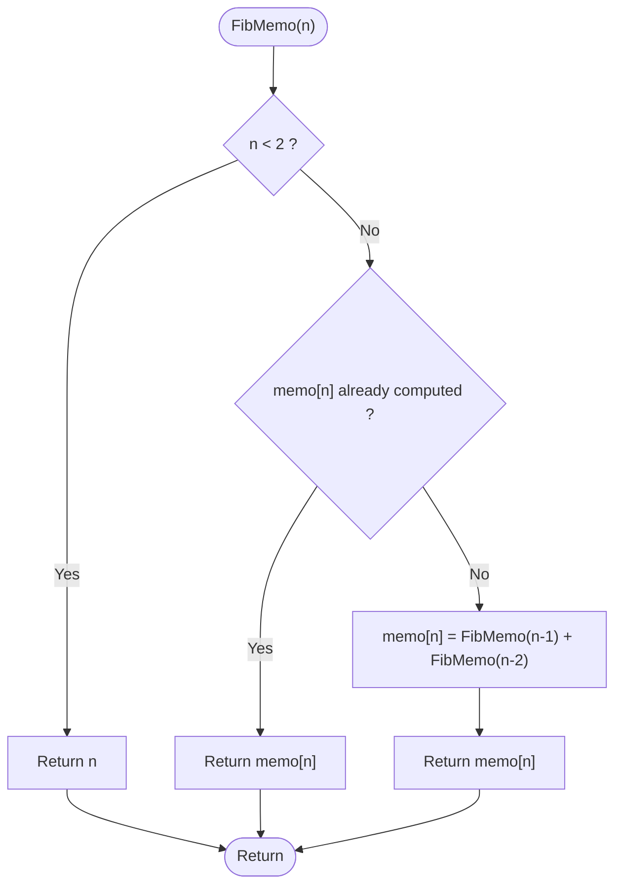
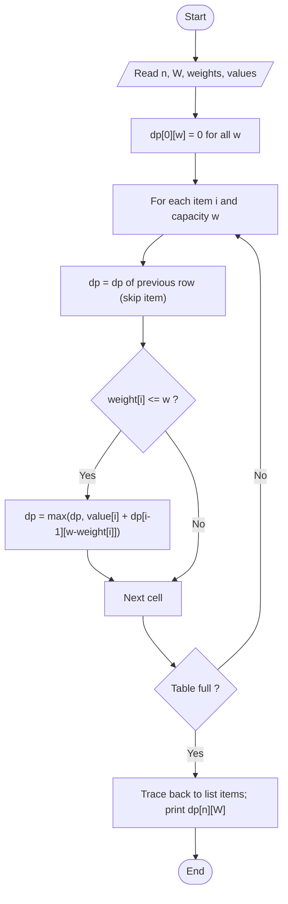
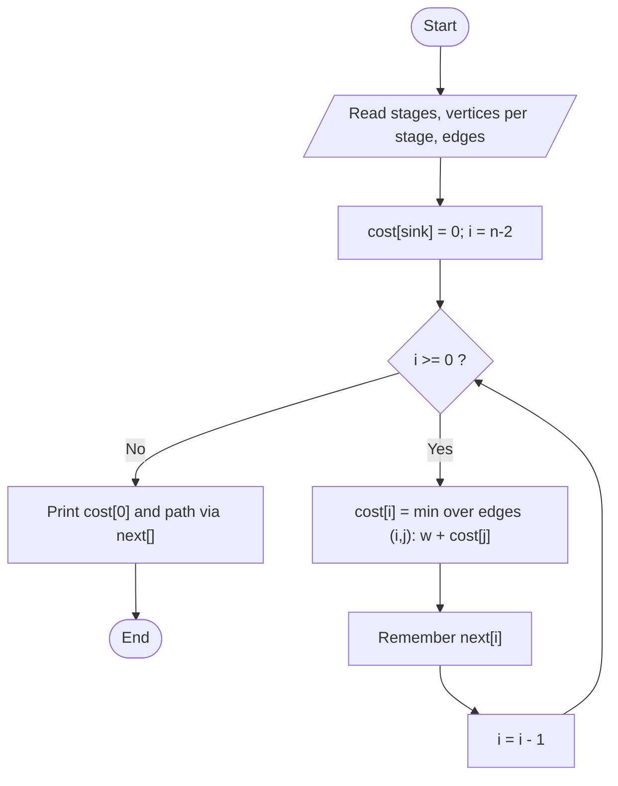
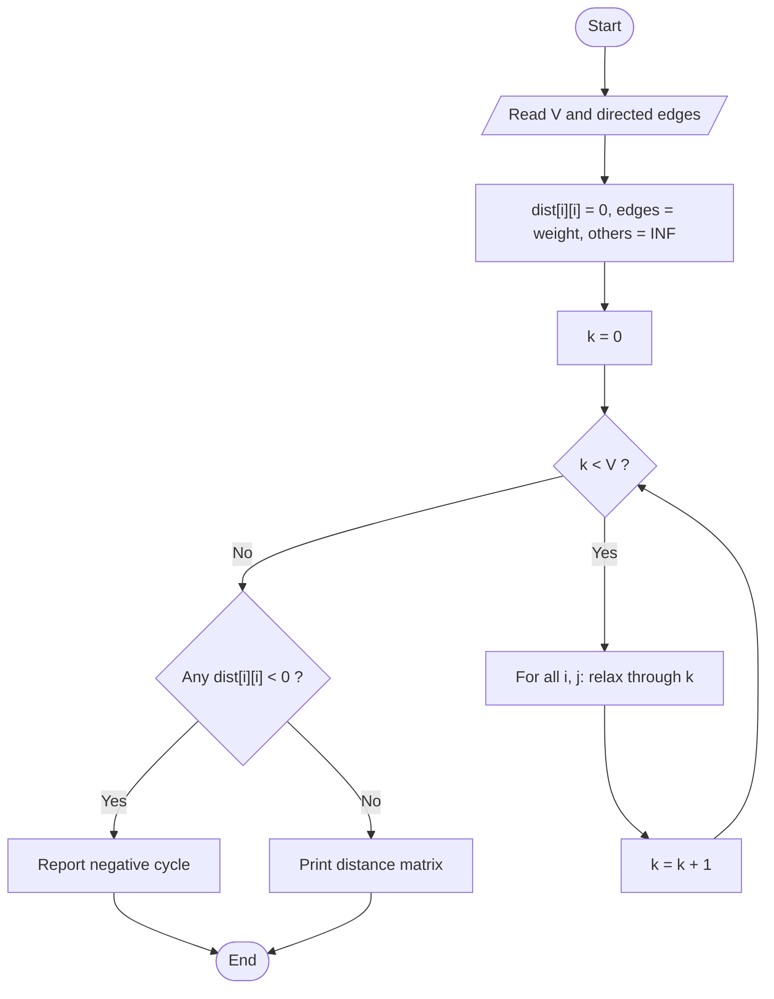
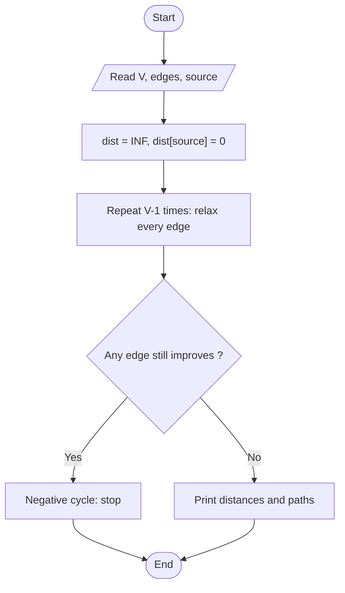
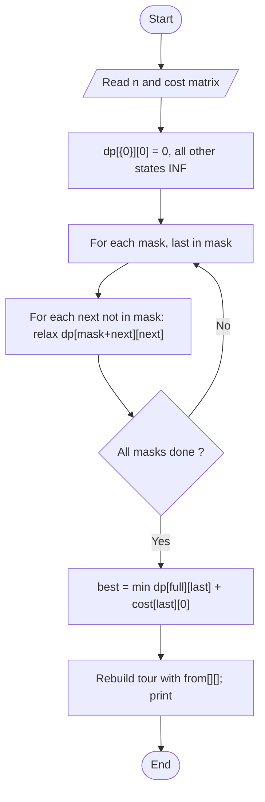

# Unit 04 - Dynamic Programming

Solve overlapping sub-problems once, store the results in a table, and reuse them. Used for optimisation problems with optimal substructure.

| Folder | Program | Worst-case time | Space |
|---|---|---|---|
| 01-Memoized-Fibonacci | [Memoized Fibonacci](01-Memoized-Fibonacci/README.md) | O(n)  (plain recursion: O(2^n)) | O(n) |
| 02-Knapsack-0-1 | [0/1 Knapsack](02-Knapsack-0-1/README.md) | O(nW) | O(nW) |
| 03-Multistage-Graph | [Multistage Graph (Shortest Path)](03-Multistage-Graph/README.md) | O(V^2) with the matrix used here | O(V^2) |
| 04-Floyd-Warshall | [Floyd-Warshall (All-Pairs Shortest Paths)](04-Floyd-Warshall/README.md) | O(V^3) | O(V^2) |
| 05-Shortest-Path-Bellman-Ford | [Single-Source Shortest Path (Bellman-Ford)](05-Shortest-Path-Bellman-Ford/README.md) | O(VE) | O(V) |
| 06-TSP | [Travelling Salesman Problem (Held-Karp DP)](06-TSP/README.md) | O(n^2 2^n) | O(n 2^n) |

Each program folder contains the C++ source, a `.txt` code explanation with the same file name, and a `README.md` (problem, approach, pseudocode, flowchart, complexity, learning outcomes).

## Memoized Fibonacci
**Problem:** Compute the n-th Fibonacci number efficiently. fib(0)=0, fib(1)=1, fib(n)=fib(n-1)+fib(n-2).

Flowchart:

Dry run:
```text
fib(5): calls fib(4) and fib(3). fib(4) calls fib(3) and fib(2) ... the first time fib(3) is solved it is stored;
the second request for fib(3) returns instantly.  Only fib(0..5) are ever computed: 2n-1 calls in total.
```
Details: [01-Memoized-Fibonacci/README.md](01-Memoized-Fibonacci/README.md)

## 0/1 Knapsack
**Problem:** Each item can be taken completely or not at all. Choose items with total weight <= W and maximum total value.

Flowchart:

Dry run:
```text
W = 8, items (w,v): 1:(2,3) 2:(3,4) 3:(4,5) 4:(5,6)
dp[4][8] = max(skip item 4 -> dp[3][8] = 9, take item 4 -> 6 + dp[3][3] = 6 + 4 = 10) = 10
trace back: item 4 taken (w -> 3); item 3: dp[3][3] = dp[2][3] -> skipped; item 2 taken (4)   => items 4 and 2
```
Details: [02-Knapsack-0-1/README.md](02-Knapsack-0-1/README.md)

## Multistage Graph (Shortest Path)
**Problem:** A directed graph is divided into stages; every edge goes from one stage to the next. Find the cheapest path from the single source (stage 1) to the single sink (last stage).

Flowchart:

Dry run:
```text
Stages: {0} {1,2,3} {4,5} {6}
cost[6]=0; cost[4]=5; cost[5]=2
cost[1]=min(4+5, 6+2)=8   cost[2]=min(2+5, 7+2)=7   cost[3]=3+2=5
cost[0]=min(5+8, 3+7, 4+5)=9 via vertex 3  -> path 0 -> 3 -> 5 -> 6
```
Details: [03-Multistage-Graph/README.md](03-Multistage-Graph/README.md)

## Floyd-Warshall (All-Pairs Shortest Paths)
**Problem:** For a directed weighted graph (negative edges allowed, no negative cycles) find the shortest distance between every pair of vertices.

Flowchart:

Dry run:
```text
Edges: 0->1:5, 0->3:10, 1->2:3, 2->3:1
initially dist[0][3] = 10.  k=1: dist[0][2] = 5+3 = 8.  k=2: dist[0][3] = min(10, 8+1) = 9.
dist[1][3] = 3+1 = 4 as well.  Unreachable pairs stay INF.
```
Details: [04-Floyd-Warshall/README.md](04-Floyd-Warshall/README.md)

## Single-Source Shortest Path (Bellman-Ford)
**Problem:** Find the shortest distance from one source vertex to every other vertex in a directed graph that may contain negative edge weights.

Flowchart:

Dry run:
```text
Classic example, source 0:  0->1:6, 0->2:7, 1->2:8, 1->3:5, 1->4:-4, 2->3:-3, 2->4:9, 3->1:-2, 4->3:7, 4->0:2
round 1 (edges in input order) gives dist = [0, 2, 7, 4, 2]; round 2 improves vertex 4 to -2 (via 0-2-3-1-4); later rounds change nothing
final dist = [0, 2, 7, 4, -2]
```
Details: [05-Shortest-Path-Bellman-Ford/README.md](05-Shortest-Path-Bellman-Ford/README.md)

## Travelling Salesman Problem (Held-Karp DP)
**Problem:** Given the cost of travelling between every pair of n cities, find the cheapest tour that visits each city exactly once and returns to the start.

Flowchart:

Dry run:
```text
4 cities, cost rows (excluding diagonal): 0:[10 15 20] 1:[10 35 25] 2:[15 35 30] 3:[20 25 30]
dp[{0,1}][1]=10, dp[{0,2}][2]=15, dp[{0,3}][3]=20
dp[{0,1,3}][3] = 10+25 = 35, dp[{0,1,3,2}][2] = 35+30 = 65, return 65+15 = 80   -> tour 0-2-3-1-0 also 80
```
Details: [06-TSP/README.md](06-TSP/README.md)
