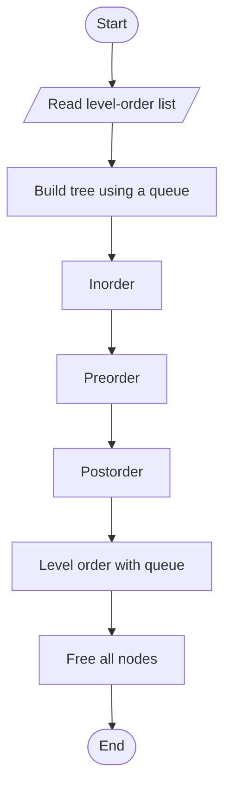

# Binary Tree Traversals

> Unit 5 - Traversal & Search Techniques &nbsp;|&nbsp; Source: [`binary_tree_traversals.cpp`](binary_tree_traversals.cpp) &nbsp;|&nbsp; Code explanation: [`binary_tree_traversals.txt`](binary_tree_traversals.txt)

## Problem Statement
Visit every node of a binary tree in inorder, preorder, postorder and level order.

## Algorithm / Approach
The tree is entered in level order (-1 = empty child) and built with a queue. Inorder (Left, Root, Right), Preorder (Root, Left, Right) and Postorder (Left, Right, Root) are depth-first and use recursion. Level order is breadth-first and uses a queue. All nodes are freed at the end.

## Pseudocode
```text
Inorder(t):   if t != null: Inorder(t.left);  visit t;  Inorder(t.right)
Preorder(t):  if t != null: visit t;  Preorder(t.left);  Preorder(t.right)
Postorder(t): if t != null: Postorder(t.left);  Postorder(t.right);  visit t
LevelOrder(root): enqueue root
    while queue not empty: t <- dequeue; visit t; enqueue t.left and t.right if present
```

## Flowchart


## Dry Run
```text
Input 1 2 3 4 5 -1 6  ->  1 has children 2,3; 2 has children 4,5; 3 has no left child and right child 6
Inorder 4 2 5 1 3 6   Preorder 1 2 4 5 3 6   Postorder 4 5 2 6 3 1   Level order 1 2 3 4 5 6
```

## Time & Space Complexity
| Best | Average | Worst | Space |
|---|---|---|---|
| O(n) | O(n) | O(n) | O(h) recursion, O(n) queue |

## Compile and Run
```powershell
g++ binary_tree_traversals.cpp -o binary_tree_traversals
.\binary_tree_traversals.exe
```

## Sample Run
```text
Enter number of entries in the level-order list (1-15): 7
Enter 7 values (0-999, or -1 for an empty child): 1 2 3 4 5 -1 6

Inorder    : 4 2 5 1 3 6 
Preorder   : 1 2 4 5 3 6 
Postorder  : 4 5 2 6 3 1 
Level order: 1 2 3 4 5 6
```


## Learning Outcomes
- Understand the three depth-first orders and where the root is visited.
- Use a queue for breadth-first order.
- Allocate and free linked nodes with `new` / `delete`.
