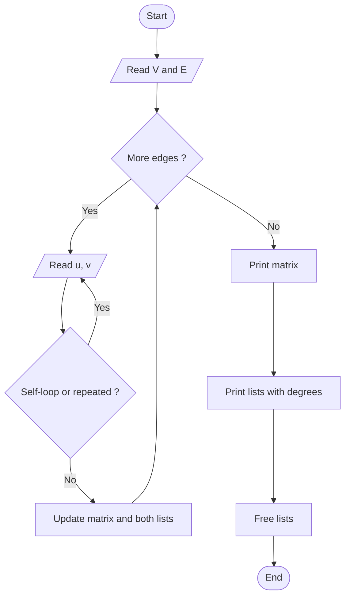

# Graph Representation

> Unit 5 - Traversal & Search Techniques &nbsp;|&nbsp; Source: [`graph_representation.cpp`](graph_representation.cpp) &nbsp;|&nbsp; Code explanation: [`graph_representation.txt`](graph_representation.txt)

## Problem Statement
Store an undirected graph in memory in the two standard ways and display both.

## Algorithm / Approach
Adjacency matrix: V x V table where matrix[i][j] = 1 if an edge exists (O(1) edge test, O(V^2) space). Adjacency list: for each vertex a linked list of its neighbours (O(V + E) space, fast to iterate neighbours). Repeated edges and self-loops are rejected. The degree of each vertex is shown.

## Pseudocode
```text
for each edge (u, v):
    matrix[u][v] <- 1;  matrix[v][u] <- 1
    append v to list[u];  append u to list[v]
print matrix;  for each vertex print its list and its length (degree)
```

## Flowchart


## Dry Run
```text
Edges 0-1, 0-4, 1-2, 1-3, 1-4, 3-4
list[0] = 1 4, list[1] = 0 2 3 4, list[2] = 1, list[3] = 1 4, list[4] = 0 1 3
the sum of degrees = 2 + 4 + 1 + 2 + 3 = 12 = 2E
```

## Time & Space Complexity
| Best | Average | Worst | Space |
|---|---|---|---|
| O(V^2) to print | O(V^2) | O(V^2) | Matrix O(V^2); list O(V + E) |

## Compile and Run
```powershell
g++ graph_representation.cpp -o graph_representation
.\graph_representation.exe
```

## Sample Run
```text
Enter number of vertices (1-8): 5
Enter number of edges: 6
Enter each edge as: u v (vertices are 0 to 4)
Edge 1: 0 1
Edge 2: 0 4
Edge 3: 1 2
Edge 4: 1 3
Edge 5: 1 4
Edge 6: 3 4

Adjacency matrix:
   0 1 2 3 4 
0: 0 1 0 0 1 
1: 1 0 1 1 1 
2: 0 1 0 0 0 
3: 0 1 0 0 1 
4: 1 1 0 1 0 

Adjacency list:
0 -> 1 4   (degree 2)
1 -> 0 2 3 4   (degree 4)
2 -> 1   (degree 1)
3 -> 1 4   (degree 2)
4 -> 0 1 3   (degree 3)
```


## Learning Outcomes
- Choose a representation by graph density.
- Work with singly linked lists and pointers.
- Relate degree sum to 2E.
