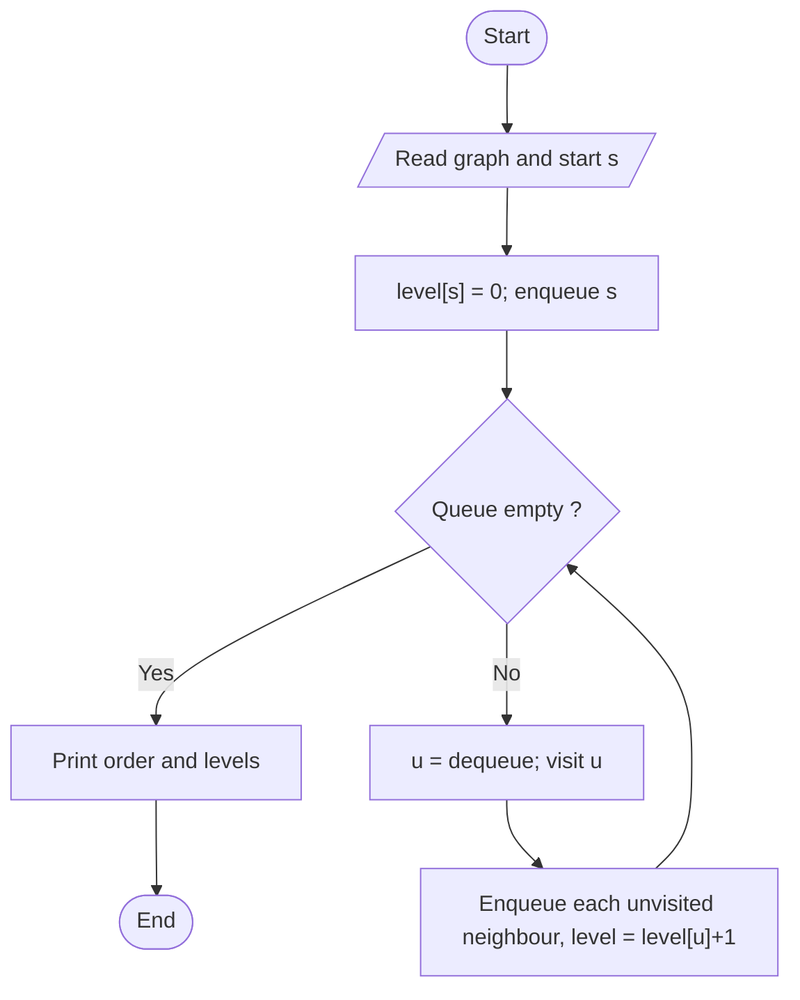

# Breadth First Search (BFS)

> Unit 5 - Traversal & Search Techniques &nbsp;|&nbsp; Source: [`bfs.cpp`](bfs.cpp) &nbsp;|&nbsp; Code explanation: [`bfs.txt`](bfs.txt)

## Problem Statement
Visit all vertices reachable from a start vertex level by level and find their distance (number of edges) from it.

## Algorithm / Approach
Use a queue. Mark the start vertex with level 0 and enqueue it. Repeatedly dequeue a vertex and enqueue each unvisited neighbour with level + 1. Because the queue is first-in-first-out, vertices are visited in increasing distance, so levels are shortest edge counts in an unweighted graph.

## Pseudocode
```text
BFS(G, s)
    level[all] <- -1;  level[s] <- 0;  enqueue s
    while queue not empty
        u <- dequeue;  visit u
        for each neighbour v of u
            if level[v] = -1 then level[v] <- level[u] + 1; enqueue v
```

## Flowchart


## Dry Run
```text
Edges 0-1, 0-2, 1-3, 2-3, 3-4, start 0
queue [0] -> visit 0, add 1,2 -> visit 1, add 3 -> visit 2 (3 already seen) -> visit 3, add 4 -> visit 4
levels: 0:0, 1:1, 2:1, 3:2, 4:3 ; vertex 5 is not reachable
```

## Time & Space Complexity
| Best | Average | Worst | Space |
|---|---|---|---|
| O(V^2) | O(V^2) | O(V^2)  (O(V + E) with adjacency lists) | O(V) |

## Compile and Run
```powershell
g++ bfs.cpp -o bfs
.\bfs.exe
```

## Sample Run
```text
Enter number of vertices (1-10): 6
Enter number of edges: 5
Enter each edge as: u v (vertices are 0 to 5)
Edge 1: 0 1
Edge 2: 0 2
Edge 3: 1 3
Edge 4: 2 3
Edge 5: 3 4
Enter start vertex: 0

BFS order: 0 1 2 3 4 

Vertex  Level (edges from 0)
0       0
1       1
2       1
3       2
4       3
5       not reachable
```


## Learning Outcomes
- Use a queue to control traversal order.
- Compute shortest hop-distance in an unweighted graph.
- Recognise unreachable vertices.
