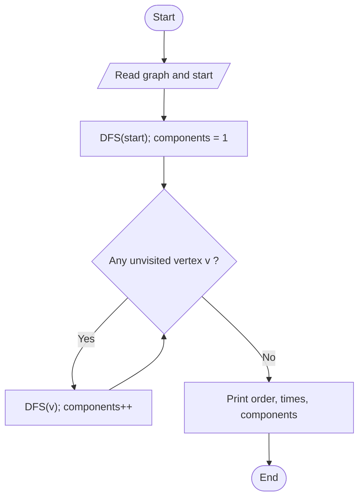

# Depth First Search (DFS)

> Unit 5 - Traversal & Search Techniques &nbsp;|&nbsp; Source: [`dfs.cpp`](dfs.cpp) &nbsp;|&nbsp; Code explanation: [`dfs.txt`](dfs.txt)

## Problem Statement
Visit all vertices by going as deep as possible before backtracking; record discovery and finish times and count connected components.

## Algorithm / Approach
Recursive DFS: mark the vertex discovered (timestamp), recursively visit each unvisited neighbour, then mark it finished (timestamp). After the start vertex's search ends, DFS is restarted from any still-unvisited vertex; every restart is a new connected component.

## Pseudocode
```text
DFS(u)
    discovery[u] <- ++time;  visit u
    for each neighbour v of u
        if v not discovered then DFS(v)
    finish[u] <- ++time

main: DFS(start);  for each vertex v not discovered: DFS(v); components++
```

## Flowchart


## Dry Run
```text
Edges 0-1, 0-2, 1-3, 2-3, 3-4, 5-6, start 0
0 (d1) -> 1 (d2) -> 3 (d3) -> 2 (d4, f5) -> back to 3 -> 4 (d6, f7) -> 3 finishes 8 -> 1 finishes 9 -> 0 finishes 10
restart at 5 -> 6 : second component.  Order: 0 1 3 2 4 | 5 6
```

## Time & Space Complexity
| Best | Average | Worst | Space |
|---|---|---|---|
| O(V^2) | O(V^2) | O(V^2)  (O(V + E) with adjacency lists) | O(V) recursion stack |

## Compile and Run
```powershell
g++ dfs.cpp -o dfs
.\dfs.exe
```

## Sample Run
```text
Enter number of vertices (1-10): 7
Enter number of edges: 6
Enter each edge as: u v (vertices are 0 to 6)
Edge 1: 0 1
Edge 2: 0 2
Edge 3: 1 3
Edge 4: 2 3
Edge 5: 3 4
Edge 6: 5 6
Enter start vertex: 0

DFS order: 0 1 3 2 4 | 5 6 

Vertex  Discovery  Finish
0       1          10
1       2          9
2       4          5
3       3          8
4       6          7
5       11          14
6       12          13
Connected components: 2
```


## Learning Outcomes
- Understand recursion as an implicit stack.
- Use discovery/finish times.
- Count connected components.
