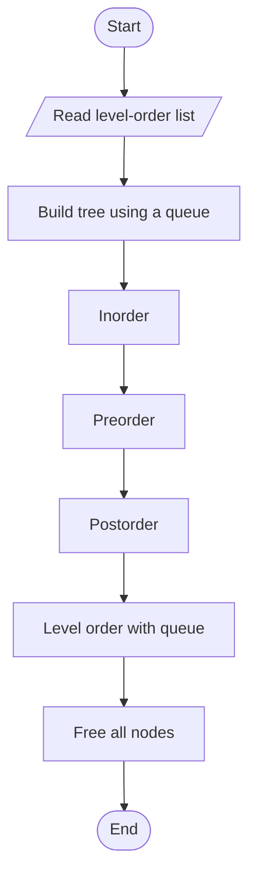
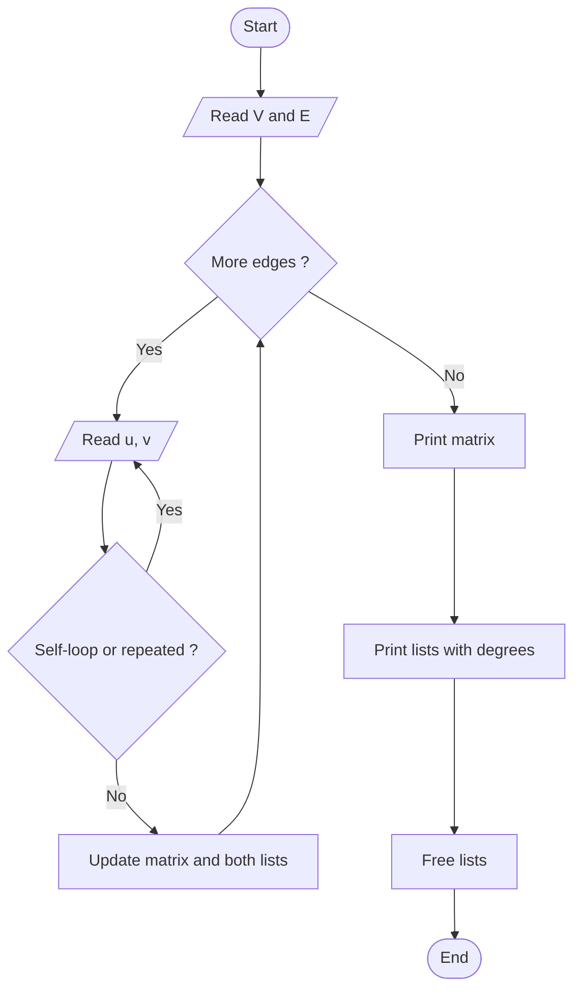
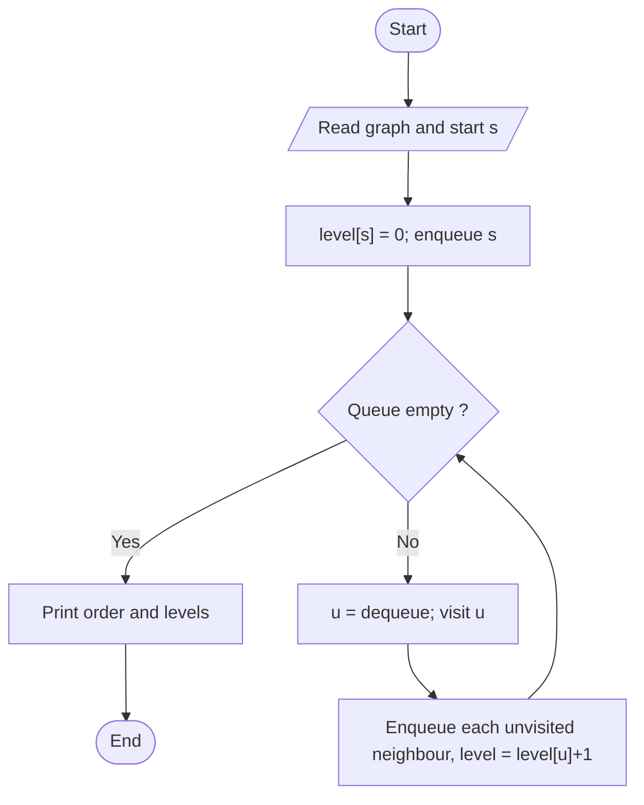
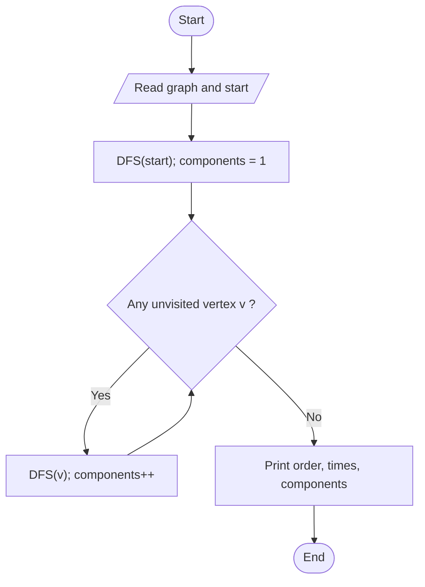

# Unit 05 - Traversal & Search Techniques

Visiting every node of a tree or graph in a systematic order: depth-first (preorder/inorder/postorder, DFS) and breadth-first (level order, BFS).

| Folder | Program | Worst-case time | Space |
|---|---|---|---|
| 01-Binary-Tree-Traversals | [Binary Tree Traversals](01-Binary-Tree-Traversals/README.md) | O(n) | O(h) recursion, O(n) queue |
| 02-Graph-Representation | [Graph Representation](02-Graph-Representation/README.md) | O(V^2) | Matrix O(V^2); list O(V + E) |
| 03-BFS | [Breadth First Search (BFS)](03-BFS/README.md) | O(V^2)  (O(V + E) with adjacency lists) | O(V) |
| 04-DFS | [Depth First Search (DFS)](04-DFS/README.md) | O(V^2)  (O(V + E) with adjacency lists) | O(V) recursion stack |

Each program folder contains the C++ source, a `.txt` code explanation with the same file name, and a `README.md` (problem, approach, pseudocode, flowchart, complexity, learning outcomes).

## Binary Tree Traversals
**Problem:** Visit every node of a binary tree in inorder, preorder, postorder and level order.

Flowchart:

Dry run:
```text
Input 1 2 3 4 5 -1 6  ->  1 has children 2,3; 2 has children 4,5; 3 has no left child and right child 6
Inorder 4 2 5 1 3 6   Preorder 1 2 4 5 3 6   Postorder 4 5 2 6 3 1   Level order 1 2 3 4 5 6
```
Details: [01-Binary-Tree-Traversals/README.md](01-Binary-Tree-Traversals/README.md)

## Graph Representation
**Problem:** Store an undirected graph in memory in the two standard ways and display both.

Flowchart:

Dry run:
```text
Edges 0-1, 0-4, 1-2, 1-3, 1-4, 3-4
list[0] = 1 4, list[1] = 0 2 3 4, list[2] = 1, list[3] = 1 4, list[4] = 0 1 3
the sum of degrees = 2 + 4 + 1 + 2 + 3 = 12 = 2E
```
Details: [02-Graph-Representation/README.md](02-Graph-Representation/README.md)

## Breadth First Search (BFS)
**Problem:** Visit all vertices reachable from a start vertex level by level and find their distance (number of edges) from it.

Flowchart:

Dry run:
```text
Edges 0-1, 0-2, 1-3, 2-3, 3-4, start 0
queue [0] -> visit 0, add 1,2 -> visit 1, add 3 -> visit 2 (3 already seen) -> visit 3, add 4 -> visit 4
levels: 0:0, 1:1, 2:1, 3:2, 4:3 ; vertex 5 is not reachable
```
Details: [03-BFS/README.md](03-BFS/README.md)

## Depth First Search (DFS)
**Problem:** Visit all vertices by going as deep as possible before backtracking; record discovery and finish times and count connected components.

Flowchart:

Dry run:
```text
Edges 0-1, 0-2, 1-3, 2-3, 3-4, 5-6, start 0
0 (d1) -> 1 (d2) -> 3 (d3) -> 2 (d4, f5) -> back to 3 -> 4 (d6, f7) -> 3 finishes 8 -> 1 finishes 9 -> 0 finishes 10
restart at 5 -> 6 : second component.  Order: 0 1 3 2 4 | 5 6
```
Details: [04-DFS/README.md](04-DFS/README.md)
