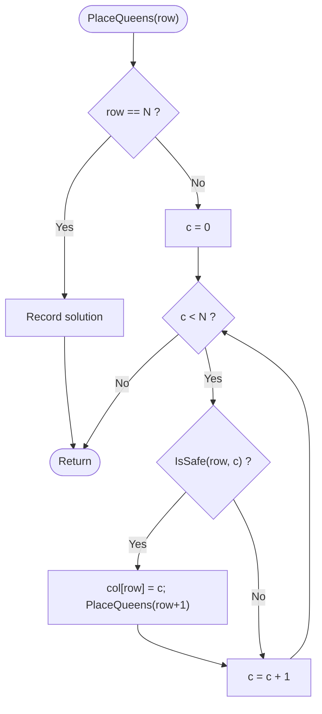

# N-Queens

> Unit 6 - Backtracking &nbsp;|&nbsp; Source: [`n_queens.cpp`](n_queens.cpp) &nbsp;|&nbsp; Code explanation: [`n_queens.txt`](n_queens.txt)

## Problem Statement
Place N queens on an N x N chessboard so that no two attack each other (no shared row, column or diagonal). Count all solutions and show the first.

## Algorithm / Approach
Place one queen per row, so rows never clash. For each row try every column; a column is allowed only if no queen above shares its column or diagonal (`isSafe`). If a queen can be placed, recurse to the next row; when the recursion returns (no column worked, or a solution was recorded) the loop simply tries the next column - this is the backtracking step.

## Pseudocode
```text
PlaceQueens(row)
    if row = N then record solution; return
    for c <- 0 to N-1
        if IsSafe(row, c) then col[row] <- c;  PlaceQueens(row + 1)

IsSafe(row, c): for r < row: if col[r] = c or |col[r] - c| = row - r then return false
                return true
```

## Flowchart


## Dry Run
```text
N = 4: row0 c0 ok -> row1: c0 same column, c1 diagonal, c2 ok -> row2: all columns attacked -> backtrack
row1 c3 ok -> row2 c1 ok -> row3: all attacked -> backtrack ... eventually row0 c1, row1 c3, row2 c0, row3 c2 works
solution columns [1 3 0 2]; N = 4 has 2 solutions, N = 8 has 92
```

## Time & Space Complexity
| Best | Average | Worst | Space |
|---|---|---|---|
| - | - | O(N!) (pruned much below that) | O(N) |

## Compile and Run
```powershell
g++ n_queens.cpp -o n_queens
.\n_queens.exe
```

## Sample Run
```text
Enter board size N (1-10): 8
Total solutions for 8 queens: 92
First solution:
Q . . . . . . . 
. . . . Q . . . 
. . . . . . . Q 
. . . . . Q . . 
. . Q . . . . . 
. . . . . . Q . 
. Q . . . . . . 
. . . Q . . . .
```


## Learning Outcomes
- Model a search as a decision tree.
- Prune invalid branches early (bounding function).
- Understand backtracking as recursion that undoes its choice.
