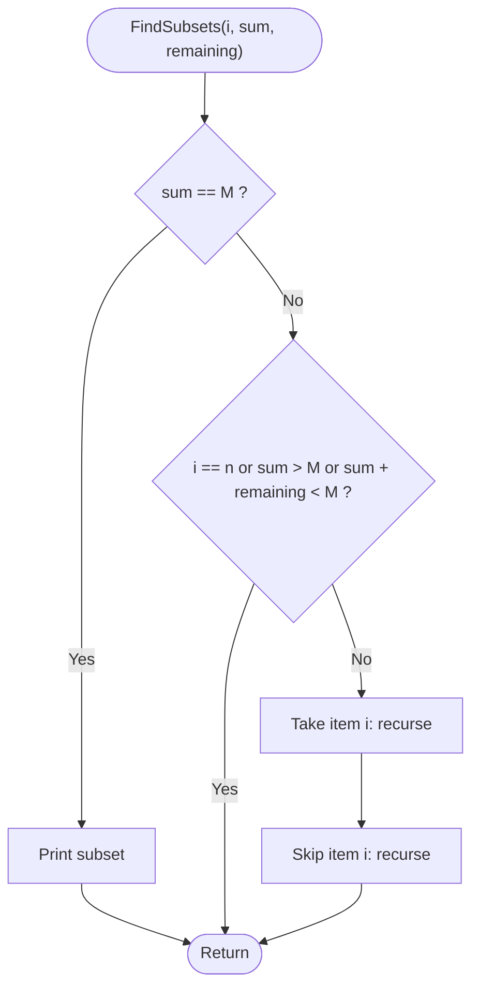

# Sum of Subsets

> Unit 6 - Backtracking &nbsp;|&nbsp; Source: [`sum_of_subsets.cpp`](sum_of_subsets.cpp) &nbsp;|&nbsp; Code explanation: [`sum_of_subsets.txt`](sum_of_subsets.txt)

## Problem Statement
Given n positive integers and a target M, list every subset whose elements add up to exactly M.

## Algorithm / Approach
Decide for each item in turn: take it or skip it (a binary decision tree). Prune a branch when the current sum already exceeds M, or when even adding all remaining items cannot reach M. When the sum equals M a solution is printed.

## Pseudocode
```text
FindSubsets(i, sum, remaining)
    if sum = M then print chosen items; return
    if i = n or sum > M or sum + remaining < M then return      # bound
    chosen[i] <- true;   FindSubsets(i+1, sum + w[i], remaining - w[i])
    chosen[i] <- false;  FindSubsets(i+1, sum, remaining - w[i])
```

## Flowchart


## Dry Run
```text
w = [5 10 12 13 15 18], M = 30
take 5, take 10, skip 12, skip 13, take 15 -> sum 30 -> {5 10 15}
take 5, skip 10, take 12, take 13 -> {5 12 13};  skip 5, skip 10, take 12, skip 13, skip 15, take 18 -> {12 18}
```

## Time & Space Complexity
| Best | Average | Worst | Space |
|---|---|---|---|
| - | - | O(2^n) | O(n) |

## Compile and Run
```powershell
g++ sum_of_subsets.cpp -o sum_of_subsets
.\sum_of_subsets.exe
```

## Sample Run
```text
Enter number of items (1-10): 6
Enter 6 positive weights: 5 10 12 13 15 18
Enter target sum (1-1000): 30

Subsets with sum 30:
{ 5 10 15 }
{ 5 12 13 }
{ 12 18 }
```


## Learning Outcomes
- Use a bounding function to cut the state-space tree.
- See that pruning does not change the worst case but helps a lot in practice.
- Print solutions from the decision array.
