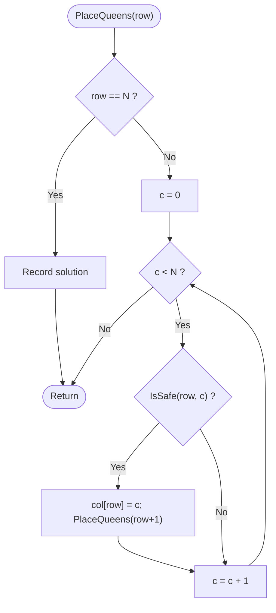
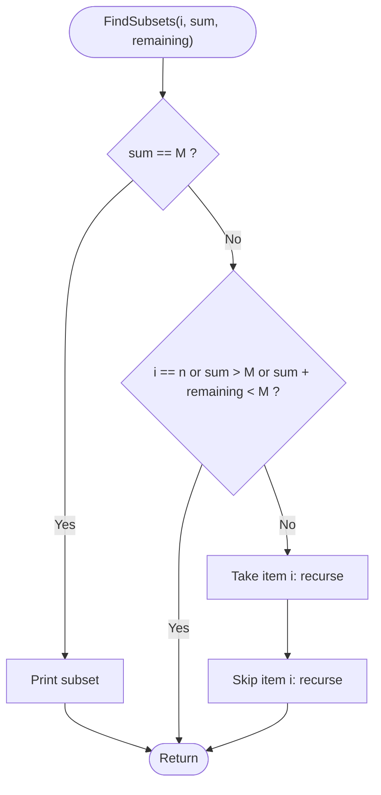

# Unit 06 - Backtracking

Build a solution one decision at a time; as soon as a partial solution cannot work, undo the last decision (backtrack) and try the next option.

| Folder | Program | Worst-case time | Space |
|---|---|---|---|
| 01-N-Queens | [N-Queens](01-N-Queens/README.md) | O(N!) (pruned much below that) | O(N) |
| 02-Sum-of-Subsets | [Sum of Subsets](02-Sum-of-Subsets/README.md) | O(2^n) | O(n) |

Each program folder contains the C++ source, a `.txt` code explanation with the same file name, and a `README.md` (problem, approach, pseudocode, flowchart, complexity, learning outcomes).

## N-Queens
**Problem:** Place N queens on an N x N chessboard so that no two attack each other (no shared row, column or diagonal). Count all solutions and show the first.

Flowchart:

Dry run:
```text
N = 4: row0 c0 ok -> row1: c0 same column, c1 diagonal, c2 ok -> row2: all columns attacked -> backtrack
row1 c3 ok -> row2 c1 ok -> row3: all attacked -> backtrack ... eventually row0 c1, row1 c3, row2 c0, row3 c2 works
solution columns [1 3 0 2]; N = 4 has 2 solutions, N = 8 has 92
```
Details: [01-N-Queens/README.md](01-N-Queens/README.md)

## Sum of Subsets
**Problem:** Given n positive integers and a target M, list every subset whose elements add up to exactly M.

Flowchart:

Dry run:
```text
w = [5 10 12 13 15 18], M = 30
take 5, take 10, skip 12, skip 13, take 15 -> sum 30 -> {5 10 15}
take 5, skip 10, take 12, take 13 -> {5 12 13};  skip 5, skip 10, take 12, skip 13, skip 15, take 18 -> {12 18}
```
Details: [02-Sum-of-Subsets/README.md](02-Sum-of-Subsets/README.md)
