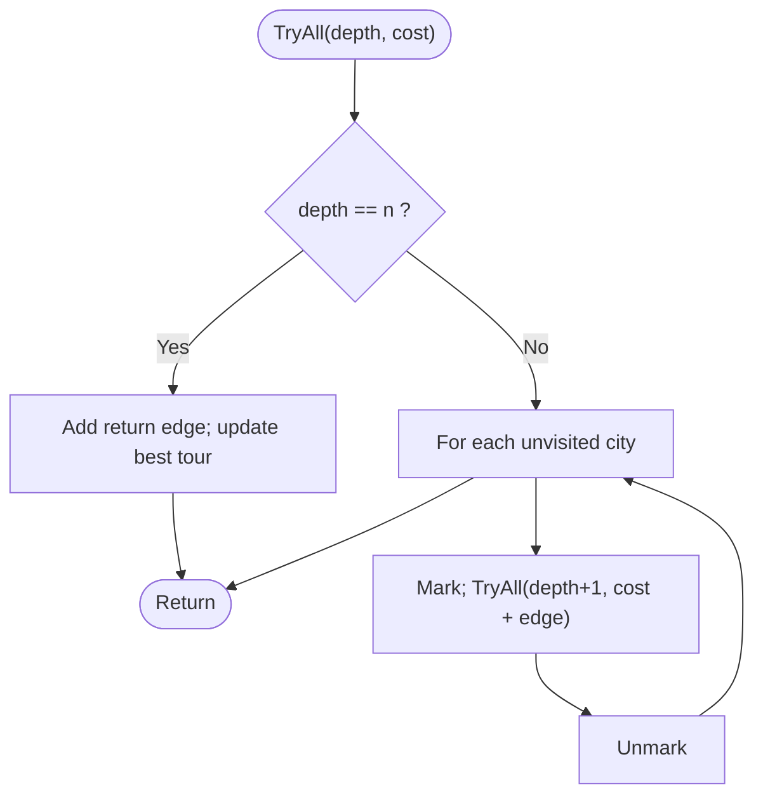

# Exhaustive Search: Travelling Salesman Problem

> Unit 7 - NP-Hard and NP-Complete Problems &nbsp;|&nbsp; Source: [`exhaustive_search.cpp`](exhaustive_search.cpp) &nbsp;|&nbsp; Code explanation: [`exhaustive_search.txt`](exhaustive_search.txt)

## Problem Statement
TSP is NP-Hard. For n cities, find the cheapest tour visiting every city once and returning to city 0, by checking every possible tour.

## Algorithm / Approach
Fix city 0 as the start and generate every ordering of the other n-1 cities with recursion (a `visited` array stops repeats). Each complete tour's cost is compared with the best so far. There are (n-1)! tours, so n is limited to 9. Exhaustive search is always correct but explodes: it is the baseline that branch and bound improves.

## Pseudocode
```text
TryAll(depth, costSoFar)
    if depth = n then total <- costSoFar + cost[last][0]; update best; return
    for city <- 1 to n-1 not visited
        mark visited; path[depth] <- city
        TryAll(depth+1, costSoFar + cost[path[depth-1]][city])
        unmark visited
```

## Flowchart


## Dry Run
```text
n = 4 -> (4-1)! = 6 tours from city 0:
0-1-2-3-0 (10+35+30+20=95)  0-1-3-2-0 (10+25+30+15=80)  0-2-1-3-0 (15+35+25+20=95)
0-2-3-1-0 (15+30+25+10=80)  0-3-1-2-0 (20+25+35+15=95)  0-3-2-1-0 (20+30+35+10=95)   best = 80
```

## Time & Space Complexity
| Best | Average | Worst | Space |
|---|---|---|---|
| O((n-1)!) | O((n-1)!) | O((n-1)!) | O(n) |

## Compile and Run
```powershell
g++ exhaustive_search.cpp -o exhaustive_search
.\exhaustive_search.exe
```

## Sample Run
```text
Enter number of cities (2-9): 4
Enter the cost matrix (1-1000), diagonal is skipped:
From city 0 to the others: 10 15 20
From city 1 to the others: 10 35 25
From city 2 to the others: 15 35 30
From city 3 to the others: 20 25 30

Tours checked    : 6
Minimum tour cost: 80
Tour: 0 -> 1 -> 3 -> 2 -> 0
```


## Learning Outcomes
- Understand why NP-Hard problems resist brute force.
- Generate permutations recursively with visited marks.
- See factorial growth: n = 9 -> 40,320 tours, n = 15 -> 8.7 x 10^10.
