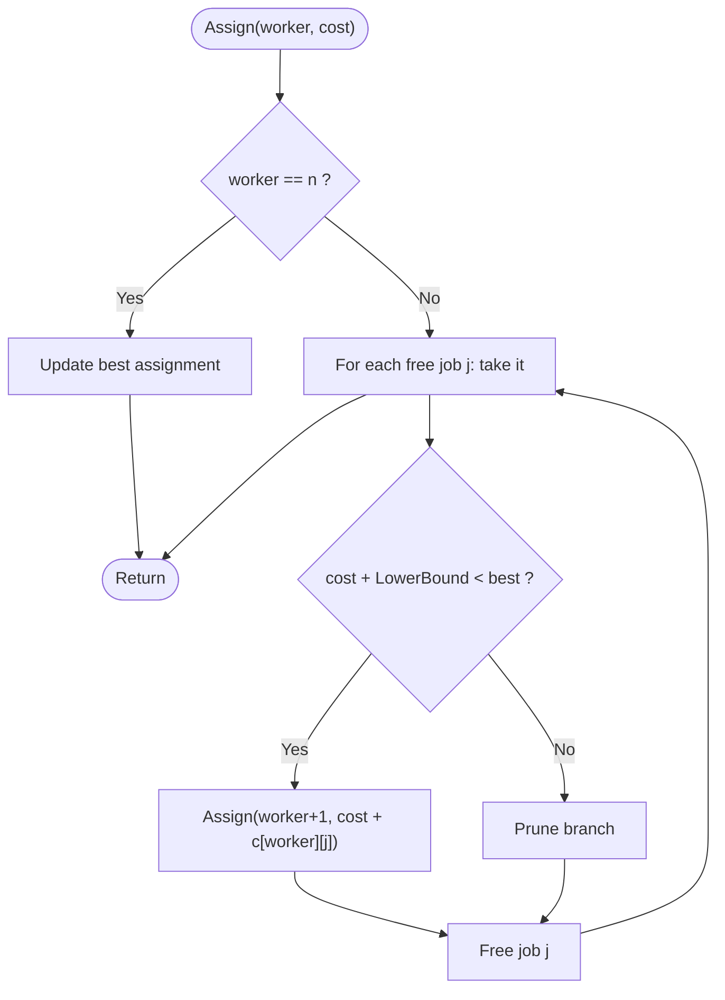

# Branch and Bound: Job Assignment

> Unit 7 - NP-Hard and NP-Complete Problems &nbsp;|&nbsp; Source: [`job_assignment_bb.cpp`](job_assignment_bb.cpp) &nbsp;|&nbsp; Code explanation: [`job_assignment_bb.txt`](job_assignment_bb.txt)

## Problem Statement
n workers and n jobs; cost[w][j] is the cost if worker w does job j. Assign one distinct job to every worker at minimum total cost.

## Algorithm / Approach
Assign workers one after another (branching over the free jobs). For a partial assignment compute a lower bound: cost so far plus, for every remaining worker, the cheapest cost among still-free jobs. If this bound is not less than the best complete assignment found, the whole branch is discarded (bounding). Without pruning there are n! assignments.

## Pseudocode
```text
Assign(worker, costSoFar)
    if worker = n then update best; return
    for each free job j
        mark j taken;  newCost <- costSoFar + cost[worker][j]
        if newCost + LowerBound(worker+1) < best then Assign(worker+1, newCost)
        mark j free
LowerBound(w): sum over remaining workers of the cheapest free job cost
```

## Flowchart


## Dry Run
```text
cost = [9 2 7 8 / 6 4 3 7 / 5 8 1 8 / 7 6 9 4]
worker 0 takes job 1 (cost 2); free jobs 0, 2, 3
bound = 2 + cheapest of row 1 (3) + row 2 (1) + row 3 (4) = 10  -> promising, continue
worker 1 -> job 0 (6), worker 2 -> job 2 (1), worker 3 -> job 3 (4): total 13 = best
all other branches have bound >= 13 and are pruned: 9 nodes explored instead of 65
```

## Time & Space Complexity
| Best | Average | Worst | Space |
|---|---|---|---|
| - | O(n!) worst case, usually far less | O(n!) | O(n) |

## Compile and Run
```powershell
g++ job_assignment_bb.cpp -o job_assignment_bb
.\job_assignment_bb.exe
```

## Sample Run
```text
Enter number of workers = jobs (1-8): 4
Enter cost[worker][job] (1-99), one row per worker:
Worker 0: 9 2 7 8
Worker 1: 6 4 3 7
Worker 2: 5 8 1 8
Worker 3: 7 6 9 4

Minimum total cost = 13
Worker 0 -> Job 1
Worker 1 -> Job 0
Worker 2 -> Job 2
Worker 3 -> Job 3
Nodes explored: 9
```


## Learning Outcomes
- Understand branching and bounding.
- Design a valid lower bound.
- Compare nodes explored against the full tree.
