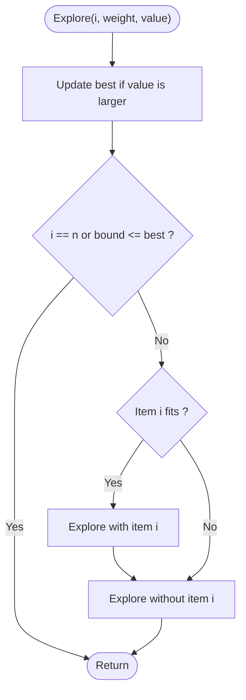

# 0/1 Knapsack by Branch and Bound

> Unit 7 - NP-Hard and NP-Complete Problems &nbsp;|&nbsp; Source: [`knapsack_bb.cpp`](knapsack_bb.cpp) &nbsp;|&nbsp; Code explanation: [`knapsack_bb.txt`](knapsack_bb.txt)

## Problem Statement
Solve the 0/1 knapsack problem (NP-Hard in its decision form) while exploring far fewer nodes than all 2^n subsets.

## Algorithm / Approach
Sort items by value/weight. Explore a binary tree: take item i or skip it. For every node compute an upper bound = current value + the fractional-knapsack value of the remaining items (an optimistic estimate). If the bound cannot beat the best value already found, prune the node. The first branch tried is 'take', which finds a good solution early.

## Pseudocode
```text
Explore(i, weight, value)
    if value > best then best <- value; save chosen
    if i = n or UpperBound(i, weight, value) <= best then return
    if weight + w[i] <= W then Explore(i+1, weight + w[i], value + v[i])      # take
    Explore(i+1, weight, value)                                               # skip
```

## Flowchart


## Dry Run
```text
W = 16, items sorted by ratio: (2,40) (5,30) (10,50) (5,10)
take item (2,40) -> 40; take (5,30) -> 70, weight 7; take (10,50) does not fit (17 > 16); take (5,10) -> 80
backtrack: skip (5,30), take (10,50) -> 90, weight 12.  Remaining nodes have bound <= 90 -> pruned.  Answer 90 (11 of 31 nodes)
```

## Time & Space Complexity
| Best | Average | Worst | Space |
|---|---|---|---|
| - | much less than 2^n in practice | O(2^n) | O(n) |

## Compile and Run
```powershell
g++ knapsack_bb.cpp -o knapsack_bb
.\knapsack_bb.exe
```

## Sample Run
```text
Enter number of items (1-15): 4
Enter knapsack capacity (1-500): 16
Item 1 - weight and value: 2 40
Item 2 - weight and value: 5 30
Item 3 - weight and value: 10 50
Item 4 - weight and value: 5 10

Maximum value = 90
Items taken: 1 3
Nodes explored: 11 (full tree has 31)
```


## Learning Outcomes
- Compute an upper bound for a maximisation problem.
- Compare with dynamic programming (O(nW)) and exhaustive search.
- See that pruning quality decides performance.
