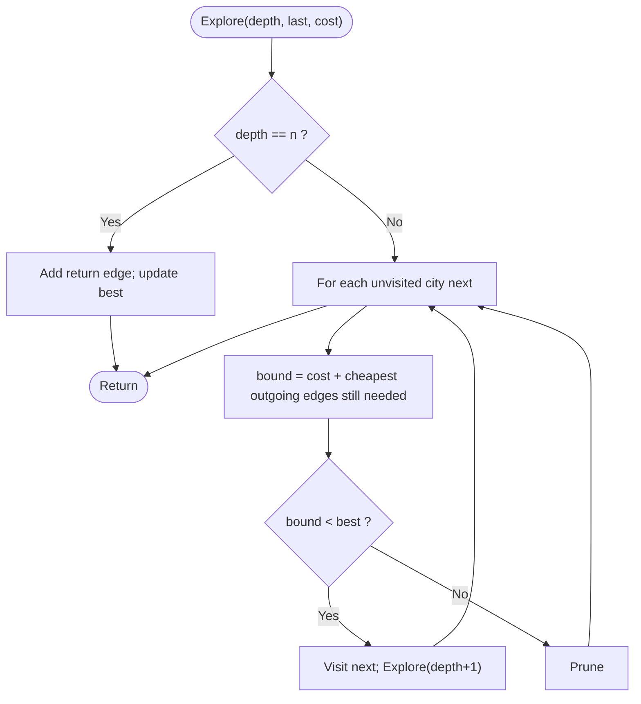

# TSP by Branch and Bound

> Unit 7 - NP-Hard and NP-Complete Problems &nbsp;|&nbsp; Source: [`tsp_bb.cpp`](tsp_bb.cpp) &nbsp;|&nbsp; Code explanation: [`tsp_bb.txt`](tsp_bb.txt)

## Problem Statement
Solve the Travelling Salesman Problem exactly, but prune partial tours that cannot lead to a better tour than the best one found so far.

## Algorithm / Approach
Extend tours city by city as in exhaustive search. For each partial tour compute a lower bound = cost so far + the cheapest outgoing edge of the current city + the cheapest outgoing edge of every unvisited city (each of them must still leave once). If the bound is >= the best complete tour, the branch is cut. Compare the nodes explored with the exhaustive count.

## Pseudocode
```text
Explore(depth, last, costSoFar)
    if depth = n then total <- costSoFar + cost[last][0]; update best; return
    for next <- 1 to n-1 not visited
        newCost <- costSoFar + cost[last][next]
        bound <- newCost + minOut[next] + sum of minOut[c] for unvisited c
        if bound < best then mark next; Explore(depth+1, next, newCost); unmark next
```

## Flowchart


## Dry Run
```text
5 cities, cheapest outgoing edges minOut = [8, 2, 3, 4, 2], so every tour costs at least 19
partial tour 0-3-2 costs 19 + 6 = 25; bound = 25 + minOut[2] (3) + minOut of unvisited 1 and 4 (2 + 2) = 32
once a tour of cost 32 is known, 0-3-2 is pruned without exploring its sub-tree
result: 37 nodes explored instead of 65 for n = 5 (the saving grows quickly with n)
```

## Time & Space Complexity
| Best | Average | Worst | Space |
|---|---|---|---|
| - | much less than (n-1)! in practice | O(n!) | O(n) |

## Compile and Run
```powershell
g++ tsp_bb.cpp -o tsp_bb
.\tsp_bb.exe
```

## Sample Run
```text
Enter number of cities (2-10): 5
Enter the cost matrix (1-1000), diagonal is skipped:
From city 0 to the others: 12 10 19 8
From city 1 to the others: 12 3 7 2
From city 2 to the others: 10 3 6 20
From city 3 to the others: 19 7 6 4
From city 4 to the others: 8 2 20 4

Minimum tour cost = 32
Tour: 0 -> 2 -> 1 -> 3 -> 4 -> 0
Nodes explored: 37 (exhaustive search: 65)
```


## Experiment: Nodes Explored (Exhaustive vs Branch and Bound)
Average over 8 random cost matrices per n; both programs returned the same minimum cost every time (verified). Data: [`tsp_nodes.csv`](../../docs/complexity-analysis/tsp_nodes.csv)

| n | exhaustive_nodes | branch_and_bound_nodes_avg |
|---|---|---|
| 4 | 16 | 10.2 |
| 5 | 65 | 22.4 |
| 6 | 326 | 79.2 |
| 7 | 1,957 | 194.6 |
| 8 | 13,700 | 284.9 |
| 9 | 109,601 | 999.5 |


Exhaustive search grows factorially; branch and bound visits only a small fraction, and the gap widens with n. The worst case is still exponential - the bound only helps when it prunes well.

## Learning Outcomes
- Design a simple lower bound for TSP.
- Compare exact methods: brute force O(n!), DP O(n^2 2^n), branch and bound.
- Understand that NP-Hard problems need smart pruning or approximation.
