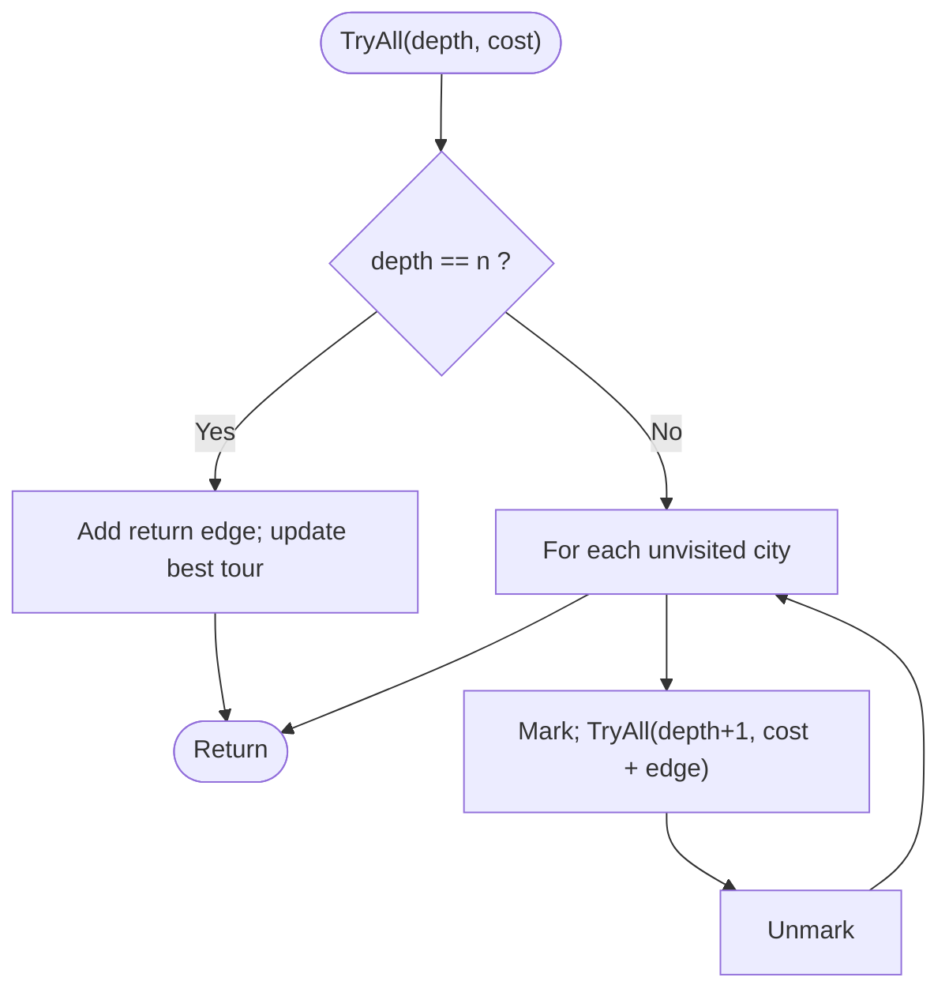
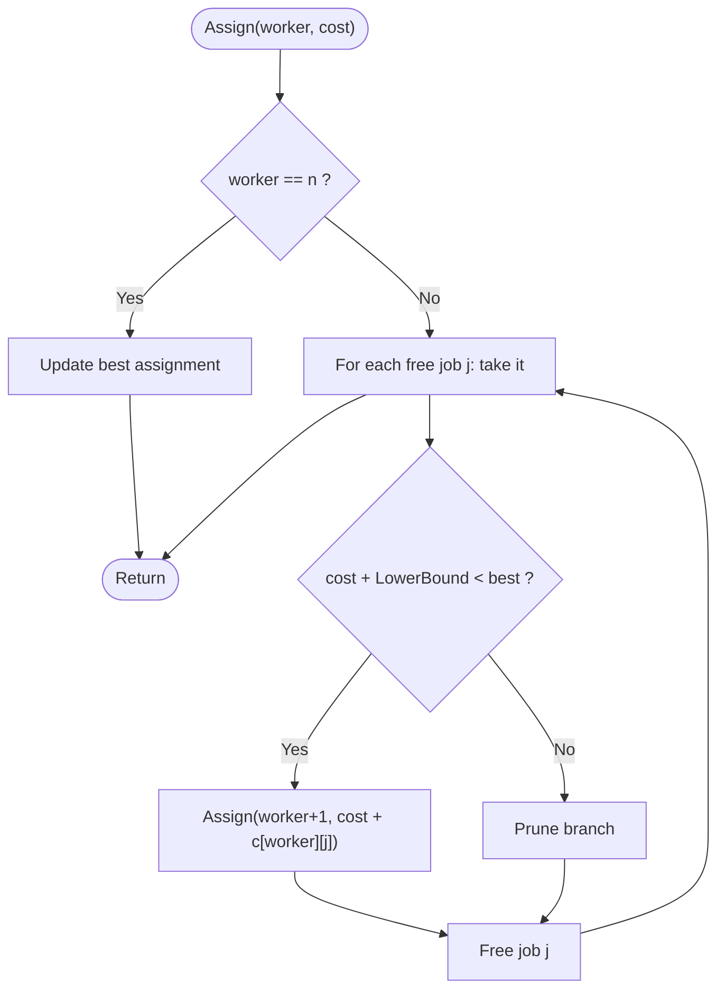
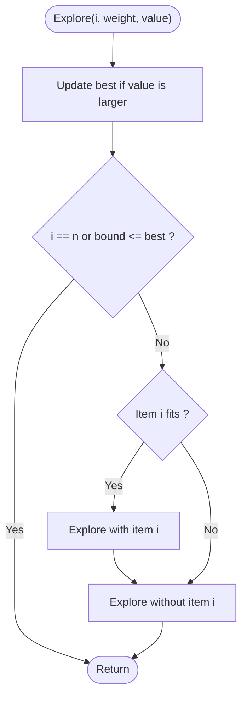
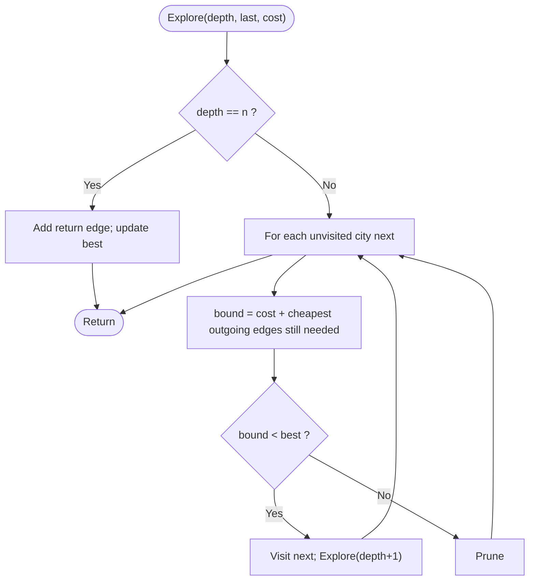

# Unit 07 - NP-Hard and NP-Complete Problems

Problems with no known polynomial-time algorithm. We solve small instances by exhaustive search and make them faster with branch and bound.

| Folder | Program | Worst-case time | Space |
|---|---|---|---|
| 01-Exhaustive-Search | [Exhaustive Search: Travelling Salesman Problem](01-Exhaustive-Search/README.md) | O((n-1)!) | O(n) |
| 02-Branch-and-Bound-Assignment | [Branch and Bound: Job Assignment](02-Branch-and-Bound-Assignment/README.md) | O(n!) | O(n) |
| 03-Knapsack-Branch-and-Bound | [0/1 Knapsack by Branch and Bound](03-Knapsack-Branch-and-Bound/README.md) | O(2^n) | O(n) |
| 04-TSP-Branch-and-Bound | [TSP by Branch and Bound](04-TSP-Branch-and-Bound/README.md) | O(n!) | O(n) |

Each program folder contains the C++ source, a `.txt` code explanation with the same file name, and a `README.md` (problem, approach, pseudocode, flowchart, complexity, learning outcomes).

## Exhaustive Search: Travelling Salesman Problem
**Problem:** TSP is NP-Hard. For n cities, find the cheapest tour visiting every city once and returning to city 0, by checking every possible tour.

Flowchart:

Dry run:
```text
n = 4 -> (4-1)! = 6 tours from city 0:
0-1-2-3-0 (10+35+30+20=95)  0-1-3-2-0 (10+25+30+15=80)  0-2-1-3-0 (15+35+25+20=95)
0-2-3-1-0 (15+30+25+10=80)  0-3-1-2-0 (20+25+35+15=95)  0-3-2-1-0 (20+30+35+10=95)   best = 80
```
Details: [01-Exhaustive-Search/README.md](01-Exhaustive-Search/README.md)

## Branch and Bound: Job Assignment
**Problem:** n workers and n jobs; cost[w][j] is the cost if worker w does job j. Assign one distinct job to every worker at minimum total cost.

Flowchart:

Dry run:
```text
cost = [9 2 7 8 / 6 4 3 7 / 5 8 1 8 / 7 6 9 4]
worker 0 takes job 1 (cost 2); free jobs 0, 2, 3
bound = 2 + cheapest of row 1 (3) + row 2 (1) + row 3 (4) = 10  -> promising, continue
worker 1 -> job 0 (6), worker 2 -> job 2 (1), worker 3 -> job 3 (4): total 13 = best
all other branches have bound >= 13 and are pruned: 9 nodes explored instead of 65
```
Details: [02-Branch-and-Bound-Assignment/README.md](02-Branch-and-Bound-Assignment/README.md)

## 0/1 Knapsack by Branch and Bound
**Problem:** Solve the 0/1 knapsack problem (NP-Hard in its decision form) while exploring far fewer nodes than all 2^n subsets.

Flowchart:

Dry run:
```text
W = 16, items sorted by ratio: (2,40) (5,30) (10,50) (5,10)
take item (2,40) -> 40; take (5,30) -> 70, weight 7; take (10,50) does not fit (17 > 16); take (5,10) -> 80
backtrack: skip (5,30), take (10,50) -> 90, weight 12.  Remaining nodes have bound <= 90 -> pruned.  Answer 90 (11 of 31 nodes)
```
Details: [03-Knapsack-Branch-and-Bound/README.md](03-Knapsack-Branch-and-Bound/README.md)

## TSP by Branch and Bound
**Problem:** Solve the Travelling Salesman Problem exactly, but prune partial tours that cannot lead to a better tour than the best one found so far.

Flowchart:

Dry run:
```text
5 cities, cheapest outgoing edges minOut = [8, 2, 3, 4, 2], so every tour costs at least 19
partial tour 0-3-2 costs 19 + 6 = 25; bound = 25 + minOut[2] (3) + minOut of unvisited 1 and 4 (2 + 2) = 32
once a tour of cost 32 is known, 0-3-2 is pruned without exploring its sub-tree
result: 37 nodes explored instead of 65 for n = 5 (the saving grows quickly with n)
```
Details: [04-TSP-Branch-and-Bound/README.md](04-TSP-Branch-and-Bound/README.md)
